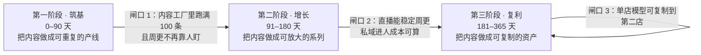
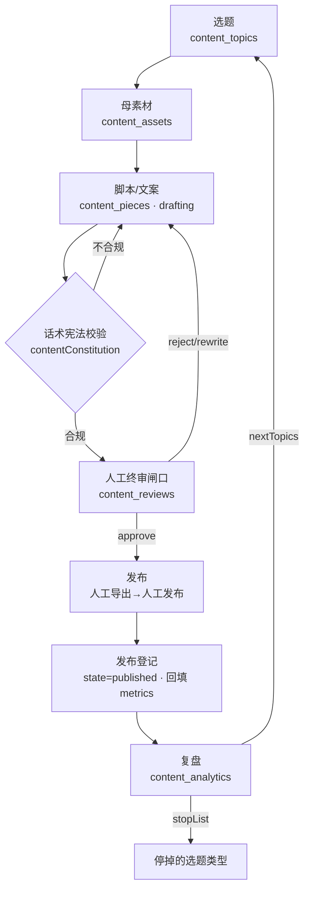

# 山海造物 · 内容体系总纲 · 三阶段路线图

> 版本 v1.0 · 2026-09-21 · 编制依据：`docs/项目总览与后续工作框架.md`、`miniprogram/docs/brand-vi-manual-v2.md`、
> `admin/docs/内容工厂_Phase1_技术蓝图.md`、`admin/src/config/contentConstitution.js`、`miniprogram/docs/live-streaming.md`、
> `admin/docs/直播管理_Phase1.md`、`docs/祈福墙_PRD_v1_2026-09-20.md`、`docs/物料码埋点与转化监测_2026-09-20.md`
>
> **本文件是内容体系的总入口。** 四个子文件（拍摄 / 账号 / 直播 / 私域）都以本文件的目标与阶段为准，
> 冲突时以本文件为上位口径。
>
> ⚠️ **本套文档是「作战规划」，不是「已发生的交付」。** 凡涉及平台规则、合规红线、账号现状、
> 人力与预算数字，凡本文件未标注「已核实」的，一律是**待产品负责人确认项**，见 §8。
> 仓库内的技术能力（内容工厂、小程序直播、物料码埋点）是**已建成**的，这部分可当既成事实用。

---

## 0. 一句话

**用「双 IP 内容池 + 内容工厂中台 + 三平台账号矩阵 + 馆内直播 + 小程序私域」五件套，
把山海造物从「有好东西但没人看见」推进到「可持续、可复盘、可复制的自然博物内容品牌」。**

---

## 1. 现状盘点（开工前必须承认的事实）

### 1.1 已经有的（可直接用，不要重造）

| 资产 | 位置 | 能支撑什么内容动作 | 核实状态 |
|------|------|-------------------|---------|
| **内容工厂中台**（5 Tab：看板/选题库/母素材库/复盘/话术宪法） | `admin/src/components/ContentFactory.vue` + `admin/src/utils/contentDb.js`（集合 `content_topics` / `content_assets` / `content_pieces` / `content_reviews` / `content_analytics`） | 选题→脚本→终审→发布登记→复盘全链路有状态 | ✅ 代码在库 |
| **话术宪法**（硬规则） | `admin/src/config/contentConstitution.js` | 所有文案/分镜口播的合规闸门 | ✅ 代码在库 |
| **双 IP 设定** | 同上 `IP_TONE`：`GRAVITY`（沉静·慢·禁刺激词）/ `LIGHTNESS`（明亮·亲切·禁直播腔） | 天然对应的**两条账号人格**，不是重复铺号 | ✅ 代码在库 |
| **小程序馆内直播** | `live-pusher` 推流 + `live-player` 拉流 + `live_sessions`/`live_messages`/`live_reminders`；主播工作台 `subpackages/business/live/studio/index`；开关 `showLive`（默认 **false**） | 店长/超管可在小程序内开播、挂车、C 端观看 | ✅ 已建成，**默认关闭待开** |
| **ERP 直播管理** | `admin/src/components/LiveSessions.vue`（id 73，业务运营→体验营销） | 总部看场次/挂车数/在线，异常强制结束 | ✅ 代码在库 |
| **41 篇社区内容**（10 展览 + 2 视频 + 3 文章 + 26 UGC 科普；另有 1 份 README） | `docs/社区内容重写_2026-09-15/` | **现成的选题库与脚本母本**，可直接改写成短视频脚本 | ✅ 文档在库（已实测清点：`ls *.md` 去 README = 41） |
| **商品事实源** | `src/data/priceList.ts`：44 个 SKU / 10 类包装（玻璃罩·相框·冰箱贴·精灵球·蝶翅画·压制标本·创意摆件·首饰·收藏级标本·其它）/ 7 类生物（植物果实·海洋·蝴蝶·昆虫·哺乳动物·两栖动物·爬行动物） | 片单可以按「品类 × 题材」双维排产，与价目表筛选口径一致 | ✅ 代码在库 |
| **物料码埋点与归因** | `entrySource` 全会话携带 + 事件 `qr_material_enter`；报表见 `docs/物料码埋点与转化监测_2026-09-20.md` | 直播/内容的**线下→线上归因**已有口径 | ✅ 文档在库 |
| **祈福墙** | `docs/祈福墙_PRD_v1_2026-09-20.md`（黑马标本的数字孪生、UGC 引擎、注册转化钩子） | 私域的**留存与 UGC 阵地** | ✅ 文档在库 |
| **Ritual / 彩蛋机制** | `docs/仪式感与彩蛋机制_长线框架_2026-09-16.md` | 直播与内容的「仪式感」素材来源 | ✅ 文档在库 |

### 1.2 明确**没有**的（不要在规划里假装它存在）

| 缺口 | 影响 | 本规划的处置 |
|------|------|-------------|
| **外部平台账号与粉丝底盘**（抖音/小红书/视频号做到什么程度未知） | 所有冷启动目标只能写成「相对里程碑」，不能写绝对粉丝数承诺 | §8 待确认项 Q1；子文件按「0 粉假设」写冷启动 |
| **拍摄设备/影棚/固定机位清单** | 产能无法估算 | `docs/内容体系_拍摄与片单_2026-09-21.md` §1 给最低可行设备包 |
| **专职内容人力编制** | 周更条数不可承诺 | §7 给「1 人 / 2 人 / 3 人」三档产能对照 |
| **自动发布第三方平台** | 内容工厂蓝图已明确**不做**（无开放 API，违规） | 全流程保留「人工导出/复制→人工发布」闸口 |
| **数字人直播** | 蓝图 Phase 3 才评估，且仅限转化场 | 本规划不排 |

---

## 2. 内容体系的四条主脉（内容支柱 Pillars）

所有内容只能落进这四条脉，**不在这四条里的选题一律退回选题库 `archived`**。
四条脉与品牌官网「五感 / 六观」体系同源，保证线上内容与官网、小程序、门店说的是同一件事。

| # | 主脉 | 内容内核 | 主要承载「IP」 | 代表形式 | 对应既有资产 |
|---|------|---------|--------------|---------|-------------|
| **P1** | **光与容器**（把自然带回家） | 不写标本本身，写**光、空气、季节、容器、看的人**——话术宪法的正面表达 | `GRAVITY` 为主 | 15–30s 空镜 + 环境音、器物陈列、家居场景 | 官网 `/how/senses`、`docs/社区内容重写` 展览类 |
| **P2** | **手上的工序** | 选料、量切、榫钉、封背、透光检查——**可复核的尺度与手感** | `GRAVITY` | 60–180s 工艺纪录片、一镜到底、工具特写 | `文章_video_workshop_tour.md`（1721 字制框日常，现成分镜母本） |
| **P3** | **博物小课** | 物种、产地、季节、湿度、学名读法——**知识底蕴，不授课腔** | 双 IP 通用 | 30–60s 知识点、图鉴对照、误区纠正 | 官网 `/foundation/{nature,…}`、`主题名候选`文档、41 篇社区内容 |
| **P4** | **人在山海** | 顾客、员工、主理人、店里的猫、祈福的人——**人情味** | `LIGHTNESS` 为主 | 15–45s 人物切片、顾客开箱、寄语朗读 | 祈福墙 PRD、`docs/仪式感与彩蛋机制_长线框架` |

### 2.1 内容配比（按阶段调整，是**排产约束**不是口号）

| 阶段 | P1 光与容器 | P2 手上的工序 | P3 博物小课 | P4 人在山海 |
|------|-----------|-------------|-----------|-----------|
| 第一阶段（0–90 天） | 30% | **40%** | 20% | 10% |
| 第二阶段（91–180 天） | 25% | 30% | 25% | **20%** |
| 第三阶段（181–365 天） | 25% | 25% | 25% | 25% |

**为什么第一阶段把 P2 压到 40%**：手艺工序是**唯一「别人抄不走、且不需要粉丝基础就能被推荐」**的内容类型，
冷启动期用它建立「真在做东西」的可信度；P4 依赖有人，冷启动期没人，所以压到 10%。

---

## 3. 三阶段路线图（主线）

### 3.1 第一阶段 · 筑基（第 0–90 天）

**阶段命题**：把「偶尔拍一条」变成「每周稳定出货」，并让内容工厂真的被用起来。

| 板块 | 目标 | 量化验收 |
|------|------|---------|
| 拍摄 | 建立 1 个可重复的拍摄日（每周固定 1 天），沉淀**首批 30 个母素材** | `content_assets` 落库 ≥ 30 条；每条带客观描述供改写 Agent 用 |
| 内容工厂 | 全链路跑通：选题→脚本→终审→发布登记→复盘至少**满 100 条**成品 | `content_pieces` 中 `state=published` ≥ 100（三平台合计） |
| 账号 | 三平台各 1 主账号完成定位、主页装修、冷启动前 30 条 | 主页五件套齐（头像/昵称/简介/背景/置顶）；周更 ≥ 3 条/平台 |
| 直播 | 馆内直播端到端打通并**首播 4 场**（`showLive` 开启） | 4 场有完整「前中后」记录与复盘；无 P0 事故 |
| 私域 | 建立私域承接阵地（企业微信/社群/小程序会员三选一定口径） | 内容→私域导流路径可点通、可归因（`entrySource`） |
| 复盘 | 建立周复盘节拍（固定每周 1 次，30 分钟） | `content_analytics` 每周 ≥ 1 条；有 `stopList` |

**闸口 1（进第二阶段的条件）**：
1. 连续 4 周达到「周更 ≥ 3 条/平台」**且没有追加人力**；
2. 内容工厂 `published` 累计 ≥ 100；
3. 至少 1 条内容带来 ≥ 1 个可归因的私域新增；
4. 4 场直播复盘完成，`stopList` 已产出。

> 任何一条不满足 → **继续留在第一阶段**，不许靠加大投流硬闯（投流不解决「内容不能重复生产」这个根问题）。

### 3.2 第二阶段 · 增长（第 91–180 天）

**阶段命题**：把「能出片」升级成「有系列、有栏目、有固定观众」。

| 板块 | 目标 | 量化验收 |
|------|------|---------|
| 拍摄 | 周更提升到 5 条/平台；建立**季度拍摄季**（一次批量拍 15–20 条母素材） | 每季 1 次集中拍摄，单次产出 ≥ 15 条可用母素材 |
| 内容 | 跑出**至少 3 个固定栏目**（有名字、有片头、有更新频率） | 每个栏目 ≥ 8 期；栏目名与片头进入母素材库固定模板 |
| 账号 | 双 IP 分离运营（`GRAVITY` 走长视频/视频号，`LIGHTNESS` 走小红书/抖音） | 两套账号的评论区人群画像有可观察差异 |
| 直播 | 从「能播」到「固定播」：**每周 1 场固定档**+每月 1 场主题场 | 周更不断档 ≥ 8 周；主题场有预热-正片-返场三段 |
| 私域 | 私域从「承接」升级到「运营」：有分层、有触达节拍 | 分层规则固化；触达有节拍表；退群率可观测 |
| 复盘 | 复盘从周级升级为**选题飞轮**：复盘产出的 `nextTopics` 真的被排产 | 每月 ≥ 5 条飞轮选题进入 `picked` 并被拍出来 |

**闸口 2（进第三阶段的条件）**：
1. 3 个栏目各自成系列，且**停更 2 周不掉粉**（说明是栏目黏性不是投放幻觉）；
2. 直播固定档连续 8 周不断档；
3. 私域新增的**单客获取成本可算**（内容工时 ÷ 新增，或投放 ÷ 新增，二选一必须能算出来）；
4. 内容工厂可支撑**第二个人**按文档独立出片（有 SOP 且验证过）。

### 3.3 第三阶段 · 复利（第 181–365 天）

**阶段命题**：把内容资产变成**可复制、可变现、可传承**的东西。

| 板块 | 目标 | 量化验收 |
|------|------|---------|
| 拍摄 | 母素材库成为**可检索资产库**（按品类/题材/场景/情绪多维标签） | 任一品类能在 10 分钟内调出 ≥ 5 条历史素材 |
| 内容 | 内容反哺产品与门店：内容里跑出的概念进入 `爆品概念生成器` | ≥ 3 个内容概念转化为实际 SKU 或门店活动 |
| 账号 | 形成**账号矩阵**（主号 + 垂类号 + 门店号），且各有清晰边界 | 矩阵账号内容不串味（可用话术宪法分别校验） |
| 直播 | 直播从「档期」升级为「场馆体验」：线上直播 × 线下到店联动 | 直播引导到店可归因（物料码/预约） |
| 私域 | 私域成为**利润中心**：复购、会员、UGC 自然产出 | 祈福墙 UGC 周产出 ≥ 10 条；会员复购可观测 |
| 体系 | 输出**可交付的内容资产包**（片单模板/SOP/话术/素材库规范） | 第二家店能直接套用，无需重新设计 |

**闸口 3（长期自我评估）**：
单店内容模型是否可复制？——若复制到第二家店**不需要新增内容人力**，则体系成立。

---

## 4. 三个平台的定位（一句话版，展开见子文件）

| 平台 | 平台角色 | 用哪个人格 | 内容形态 | 转化终点 |
|------|---------|-----------|---------|---------|
| **抖音** | **拉新与破圈**（公域流量最大、算法最看「完播/互动」） | `LIGHTNESS` 为主 | 15–45s 强钩子、工艺爽感、知识反转 | 主页→私信/小程序/直播 |
| **小红书** | **种草与信任**（搜索长尾最强、用户带着目的来） | 双 IP 并用（`GRAVITY` 做质感，`LIGHTNESS` 做日常） | 图文笔记 + 30–60s 视频、合集、清单 | 笔记→评论区/私信→小程序 |
| **微信小程序 + 私域** | **承接与复购**（自己完全可控、可归因、可反复触达） | 与品牌一致的「朋友分享」语感 | 社区内容、祈福墙、直播、会员、订阅通知 | 直接成交与复购（闭环终点） |

**口径纪律**：三个平台**不是同一份内容复制三遍**。同一母素材在三个平台有**三种切法**，
但**共用一份话术宪法**（`contentConstitution.js` 是唯一守门人）。

---

## 5. 内容生产流水线（唯一标准流程）

### 5.1 每一环的「人只做四件事」原则

沿用内容工厂蓝图的原则：**人只出现在「选题挑选、真实拍摄、终审、真实私域」四处**，
其余（改写、分发切分、复盘归纳、合规初筛）由 Agent 做。

### 5.2 状态机与责任

| 状态 | 谁推进 | 卡住超过 | 处理 |
|------|-------|---------|------|
| `candidate` → `picked` | 选题会（人工挑选） | 7 天 | 归档，不要囤 |
| `topic` → `drafting` | Agent 起草 | 2 天 | 人工补一句方向 |
| `drafting` → `review` | Agent 自检通过 | 1 天 | 直接进终审 |
| `review` → `approved` | **人工终审** | 3 天 | 默认通过，除非明确违规 |
| `approved` → `scheduled` | 排期 | 3 天 | 进发布日历 |
| `scheduled` → `published` | 发布+登记 | 到期当天 | 未发布要写原因 |
| `published` → 复盘 | 复盘 Agent | 7 天 | 数据回填，进 `content_analytics` |

> **终止条件**：任何一条内容在 `review` 停超过 14 天，直接 `archived`。
> 囤积未发布内容是内容体系最常见的死法。

---

## 6. 与既有系统的对接（不许另起炉灶）

| 本规划要的事 | 用哪个既有系统 | 不允许的做法 |
|-------------|--------------|-------------|
| 选题/脚本/终审/复盘 | `ContentFactory.vue` + `contentDb.js` | ❌ 新建 Excel/飞书表格做平行流程 |
| 文案合规 | `contentConstitution.js` | ❌ 口头约定「注意别写标本做主语」 |
| 直播开播/挂车 | 小程序主播工作台 + `manageLiveSession` | ❌ ERP 侧再实现一套开播入口（蓝图已明确边界） |
| 直播监控/兜底 | `LiveSessions.vue`（id 73） | ❌ 另建看板 |
| 线下→线上归因 | `entrySource` + `qr_material_enter` | ❌ 另起一套埋点名 |
| 私域留存/UGC | 祈福墙 + 会员体系 + 订阅通知 | ❌ 另建社群工具替代小程序 |
| 爆品概念 | `爆品概念生成器` | ❌ 内容里跑出的概念只在群里口头说 |

---

## 7. 产能与人力（必须摊开算的一笔账）

**单条内容工时估算（按第一阶段标准，成品可发布）**：

| 环节 | 单条工时 | 说明 |
|------|---------|------|
| 选题 + 脚本 | 0.3 h | 有内容工厂 Agent 辅助后 |
| 拍摄 | 0.5–1.5 h | 批量拍母素材时按拆分摊销，单条更低 |
| 剪辑 + 字幕 | 0.5–1 h | 用剪映/CapCut 模板 |
| 合规 + 终审 | 0.1 h | 走内容工厂 |
| 发布 + 登记 | 0.2 h | 三平台齐发需 ×1.5 |
| **合计** | **≈ 2–3 h/条**（单平台） / **3–4 h/条**（三平台） |

**三档人力对应产能**：

| 配置 | 每周可稳定产出 | 对应阶段 | 备注 |
|------|--------------|---------|------|
| 0.5 人（兼任） | 3–4 条/周（单平台为主） | 仅够跑第一阶段最低线 | 会长期卡在闸口 1 |
| 1 人专职 + 主理人出镜 | 8–12 条/周（三平台合计） | 第一阶段正常、第二阶段起步 | **推荐起点** |
| 2 人（1 拍 1 剪）+ 主理人出镜 | 18–25 条/周 | 第二阶段稳定、第三阶段起步 | 需要拍摄季批量支撑 |

⚠️ **以上是估算，不是实测**（本仓库没有历史产能数据）。请在跑满 2 周后回来修正此表——
**修完再据此调整阶段目标**。

---

## 8. 待产品负责人确认项（开工前必须拍板，否则规划只能空转）

> 规则：这一节每一条都**不要**由施工方替你猜。拍板后请在原行补「→ 结论：…」。

| # | 问题 | 为什么必须拍板 | 影响文件 |
|---|------|--------------|---------|
| **Q1** | 抖音/小红书/视频号**现有账号**是哪些？各自粉丝量、是否已认证、是否有历史违规？ | 决定是「冷启动」还是「救活老号」，两套打法完全不同 | 账号子文件全篇 |
| **Q2** | 谁出镜？主理人可出镜时长/频率？是否有员工可授权出镜？ | 没有稳定出镜人 → P4 与直播都无法排产 | 拍摄/直播/账号 |
| **Q3** | 每周可投入内容的人力编制（见 §7 三档）？ | 直接决定周更条数与阶段推进速度 | 全部 |
| **Q4** | 拍摄预算上限（设备/场地/道具/剪辑外包）？ | 决定最低可行设备包 vs 进阶包 | 拍摄子文件 §1 |
| **Q5** | 私域承接主阵地选哪个：**企业微信** / **微信社群** / **仅小程序会员**？ | 三者的合规边界、可触达能力、运营成本差异大 | 私域子文件全篇 |
| **Q6** | 直播挂车的**商品范围**与定价权限（是否可现场改价/赠品）？ | 决定直播脚本能否含报价与促单环节 | 直播子文件 §4 |
| **Q7** | 是否接受**真人出镜的工坊纪录片**形态（慢节奏、无强钩子）？ | `GRAVITY` 人格与抖音算法偏好存在张力，需业务方拍板取舍 | 账号子文件 §3 |
| **Q8** | 合规红线确认（见 §9）由谁负责、多久复核一次？ | 标本/昆虫类目在不同平台口径不同，出错代价高 | 全部 |

---

## 9. 合规与红线（**必须人工核实，AI 不得替平台下结论**）

以下每一条都是**需要去平台后台/官方文档核实**的项目，本文件**不给出结论**，只给出**核实清单**：

| # | 核实项 | 去哪核实 | 核实的结论写在哪 |
|---|-------|---------|----------------|
| C1 | 抖音对「动物标本 / 昆虫标本」类目的**上架与直播展示**规则 | 抖音电商学习中心 / 抖店类目资质 | 本文档附录（待补） |
| C2 | 小红书对标本类内容的**社区规范**与商业化限制 | 小红书社区规范 / 专业号规则 | 同上 |
| C3 | 微信小程序**类目资质**对活体/标本/昆虫的要求（注意：活体与标本是两回事） | 微信公众平台类目要求 | 同上 |
| C4 | 直播中**展示标本**是否需要额外资质或话术限制 | 各平台直播规范 | 同上 |
| C5 | 未成年出镜、顾客肖像、门店拍摄的**授权**流程 | 内部法务口径 | 同上 |
| C6 | 内容中引用**学名/产地/保护物种**信息的准确性责任 | 内部（涉及 CITES 等） | 同上 |

**当前唯一已知的硬约束（来自仓库既有代码，可直接当事实用）**：
`admin/src/config/contentConstitution.js` 的 `STOP_LIST` 是**已经生效**的内容红线，全部四条：

| # | 红线（原文） | 对本次规划的约束 |
|---|------------|----------------|
| 1 | 不带货香氛/服饰/美妆/盲盒/潮玩/数字藏品 | 选品与挂车范围受此限制 |
| 2 | 不逼单、不虚构稀缺、不夸大功效 | 直播与文案的话术底线（见直播文件 §5.2） |
| 3 | **标本画面须真实拍摄，AI 仅可辅助氛围且须标注** | 拍摄阶段：AI 生成的氛围镜头**必须标注**；`desc` 必须客观 |
| 4 | **不自动发帖，内容经人工终审后导出/复制发布** | 流水线保留「人工终审 + 人工发布」闸口，**不得引入自动发布** |

---

## 10. 子文件索引

| 文件 | 覆盖 |
|------|------|
| `docs/内容体系_拍摄与片单_2026-09-21.md` | 拍摄场景/设备/母素材标准/片单模板/12 周排期/SOP |
| `docs/内容体系_账号培养_多平台_2026-09-21.md` | 抖音/小红书/小程序私域三平台定位、内容配比、冷启动 SOP、阶段里程碑 |
| `docs/内容体系_直播规划_2026-09-21.md` | 馆内直播 + 挂车转化、场次节奏、脚本模板、前中后 SOP |
| `docs/内容体系_私域与转化闭环_2026-09-21.md` | 导流路径、群运营、UGC/祈福墙联动、数据看板与复盘飞轮 |
| `docs/内容体系_README.md` | 本套文档的阅读入口与索引 |

---

## 11. 变更记录

| 日期 | 变更 | 作者 |
|------|------|------|
| 2026-09-21 | 首版：三阶段路线图、四主脉、流水线、产能账、待拍板 8 项、合规核实 6 项 | 施工方 |
