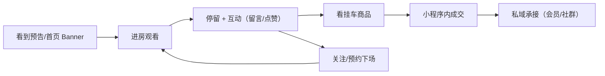

# 山海造物 · 内容体系 · 直播规划

> 版本 v1.0 · 2026-09-21 · **上位文件**：`docs/内容体系_总纲_三阶段路线图_2026-09-21.md`
> 覆盖：**馆内直播（小程序）的场次节奏、选题库、脚本模板、前中后 SOP、转化设计、复盘口径。**
>
> ⚠️ **本规划的直播是「小程序馆内直播」**——即 `miniprogram/docs/live-streaming.md` 描述的能力，
> **不是抖音/小红书第三方平台的直播带货**。第三方平台直播的合规与能力边界见总纲 §9，
> 本文件在 §10 单列「若要扩展到第三方平台」的前置条件。

---

## 1. 既成能力基线（可直接依赖，不要重造）

### 1.1 技术链路（已建成）

```
超管「内容开关」showLive（默认 false）
        │
        ▼
content_display_flags（getContentDisplayFlags）
        │
        ├─ false → C 端隐藏首页直播 Banner；watch 页拒绝进房
        └─ true  → 首页 getActive；有可拉流场次则抢插 Banner 第一帧

店长/超管「开播」→ manageLiveSession.start
        │  鉴权：staffGuard + manageLive
        │  用环境变量签发 URL；可带封面 coverUrl / 预约 scheduledAt
        ▼
腾讯云 CSS（RTMP 推 / HTTPS-FLV 拉）
        ├─ live-pusher ← pushUrl（仅主播端）
        └─ live-player ← pullUrl（观众端）
              ├─ heartbeat → 近似在线人数（presence TTL）
              └─ live_messages → 本场留言墙（限频 + 粗滤）
```

**关键事实**：

| 项 | 值 | 出处 |
|----|----|------|
| 数据源集合 | `live_sessions` / `live_messages` / `live_reminders` | `admin/docs/直播管理_Phase1.md` |
| 场次字段 | `title` / `status(idle\|live\|ended)` / `hostName` / `hostOpenid` / `startTime` / `endTime` / `scheduledAt` / `shelfProductIds` / `likeCount` / `presence` | 同上 |
| 云函数 | `manageLiveSession`：`listRecent` / `getSession` / `forceEnd`（另有 `start` / `create` / `getHostSession` / `getActive`） | 同上 + `live-streaming.md` |
| 主播入口 | 小程序「我的 → 主播工作台」（`subpackages/business/live/studio/index`），需 `live_host` 角色 | `live-streaming.md` |
| 总部入口 | ERP 业务运营 → 体验营销 → **直播管理**（`admin/src/components/LiveSessions.vue`，id `73`） | `admin/docs/直播管理_Phase1.md` |
| 开关默认值 | `showLive: false`（**开播前必须由超管打开**） | `miniprogram/cloudfunctions/getContentDisplayFlags/index.js` |
| 未配置域名时 | `start` 返回 `configured:false`，无法出画 | `live-streaming.md` |

### 1.2 能力边界（不要幻想）

| 做不到 | 说明 |
|-------|------|
| ERP 侧开播/挂车/发消息 | **设计如此**，避免与主播端双入口写同一场次 |
| C 端在直播里下单的独立链路 | `purchasable` 仅当 `showLive` 开 + `status=live` + 有 `pullUrl`；购买走既有商品链路 |
| 第三方平台（抖音/小红书）直播 | 本能力只覆盖**微信小程序内**直播 |
| 数字人直播 | 内容工厂蓝图已明确：Phase 3 才评估，且仅限转化场；**本规划不排** |
| 自动发布/自动切片 | 无开放 API；切片仍走剪映/CapCut 人工 |

---

## 2. 开播前置条件（Go-Live Checklist）

**每次开播前逐条打勾**，任何一条不满足就不开——开一场坏播比不开伤得多。

### 2.1 一次性准备（第一次开播前完成）

- [ ] 腾讯云 CSS 已开通，推流/播放域名已配置（`LIVE_PUSH_DOMAIN` / `LIVE_PLAY_DOMAIN`）
- [ ] `LIVE_AUTH_KEY` 已设置，且推流域名主 KEY 与播放域名主 KEY **相同**
- [ ] 云函数环境变量已写入并验证（`deploy-drifted --dry-run` 无漂移）
- [ ] 微信侧直播权限已开通（见 `live-streaming.md` §1–§3）
- [ ] 主播账号已授予 `live_host` 角色，且**已用自己的账号试播一次成功**
- [ ] 超管内容开关 `showLive` 已打开
- [ ] 端到端验收已完成：推流成功 → C 端能看到 → 留言能上墙 → 结束态正确
- [ ] **回滚预案**：知道怎么用 ERP「强制结束」兜底（`manageLiveSession.forceEnd`）

### 2.2 每场开播前（T-60 分钟）

- [ ] 场次已在主播工作台创建：`title` / 封面 `coverUrl` / 预约 `scheduledAt`（可选）
- [ ] 挂车商品已选（`shelfProductIds`）——**且每个商品的库存与价格已核对**
- [ ] 网络测速（**上行带宽**是直播死穴）；准备 4G/5G 备用热点
- [ ] 灯光 + 机位试拍；声音试音（回放听一遍）
- [ ] 脚本与话术已过**话术宪法**校验（见 §5）
- [ ] 留言墙**维护人**已到位（限频与粗滤之外仍需人工盯）
- [ ] 预告已发（见 §6.2）

---

## 3. 直播的定位：不是叫卖，是「工作台直播」

### 3.1 一句话定位

**把工坊的门打开，让看的人站在旁边看一会儿手在做什么——想带走什么，货架上就在那儿。**

这与话术宪法完全同构：**镜头与主播都不成为「展示标本」的主角**，
主播是「正在做事的人」，观众是「停留的人」，商品是「恰好在那里的容器」。

### 3.2 三种直播形态

| 形态 | 内容 | 时长 | 用在哪 | 阶段 |
|------|------|------|-------|------|
| **A · 工作台直播** | 真做工序：制框、封背、擦玻璃、拼角 | 60–90 min | 主力形态，第一阶段全用这个 | 第一/二/三 |
| **B · 陈列讲解** | 在陈列墙前逐件讲：产地、季节、怎么放 | 45–60 min | 有新品/新到货时 | 第二阶段起 |
| **C · 主题场** | 围绕一个主题（如「秋天被收进容器」），配活动/礼盒 | 90 min | 每月 1 场 | 第二阶段起 |

**为什么第一阶段只做 A**：A 形态**不需要口才**，只需要真的在做事。
这是唯一能在「没有主播能力、没有粉丝底盘」时开得起来的形态。

### 3.3 与品牌调性的对齐

| 规则 | 具体做法 |
|------|---------|
| 不逼单 | 不说「最后 3 件」「倒计时」；有货就说有，没货就说没 |
| 不虚构稀缺 | 不造「限量」；真实的批次差异可以讲 |
| 诚实走过问题 | 允许说「这个我做得不好，重做了两次」——**这是最强的信任来源** |
| 禁直播腔 | 禁「家人们/宝宝们/扣 1/上车」；用 `LIGHTNESS` 的日常语感 |
| 标本不做主语 | 讲商品时讲「这道光落在……」「放在你桌上会……」而非「这个标本特别好看」 |

---

## 4. 场次节奏（阶段规划）

| 阶段 | 频率 | 单场时长 | 累计目标 | 备注 |
|------|------|---------|---------|------|
| **第一阶段（0–90 天）** | **共 4 场**，前 6 周每周 1 场，之后每两周 1 场 | 60 min | 4 场 | 目标是**跑通并复盘**，不是卖货 |
| **第二阶段（91–180 天）** | **每周 1 场固定档** + 每月 1 场主题场 | 60–90 min | 周更不断档 ≥ 8 周 | 固定档建立「到点就来」的习惯 |
| **第三阶段（181–365 天）** | 每周 2 场（1 工作台 + 1 主题/陈列） + 门店联动场 | 90 min | 直播成为常态内容源 | 直播切片反哺短视频 |

### 4.1 固定档时段选择（**用数据定，不要抄**）

第一阶段 4 场的作用之一就是**试时段**：

| 场次 | 试的时段 | 观察 |
|------|---------|------|
| 第 1 场 | 周三 20:00 | 晚间居家流量 |
| 第 2 场 | 周六 15:00 | 周末午后 |
| 第 3 场 | 周五 12:30 | 午休 |
| 第 4 场 | 周日 20:00 | 周末晚间 |

→ 4 场后比较 `presence` 峰值与停留，**选最好的时段固定下来**。

### 4.2 与内容排期的咬合

直播不是独立项目，是**内容排期的一部分**（见拍摄文件 §6.2 的周节拍）：

| 星期 | 动作 |
|------|------|
| 周一 | 拍摄日 → 顺手把直播要用的工序也拍一遍（**直播是「长版」，短视频是「切片」**） |
| 周三/五 | 直播日 |
| 次日 | **切片**：从回放切 2–3 条短视频，进内容工厂当成品 |

> **这是本规划最重要的一条效率设计**：一场 60 分钟的直播，天然产出 2–3 条短视频素材。
> 直播不是额外成本，是**母素材的第二来源**。

---

## 5. 脚本模板

### 5.1 工作台直播脚本骨架（60 分钟）

| 时间 | 环节 | 说什么 | 做什么 |
|------|------|-------|-------|
| 0:00–0:05 | **开场：说明今天做什么** | 「今天做的是这副框的封背，前面切角已经做完了。」 | 把材料摆好，镜头对正 |
| 0:05–0:20 | **第一段工序（完整走一遍）** | 讲**为什么这么做**：尺度、留一线、为什么先干擦 | 手上动作不停 |
| 0:20–0:25 | **回应留言** | 挑 3–5 条留言回答（**留言本身就是选题**） | 停手，看镜头 |
| 0:25–0:40 | **第二段工序** | 讲**踩过的坑**：这次哪一步返工了 | 继续做 |
| 0:40–0:50 | **陈列/货架** | 讲 2–3 件商品：产地、季节、放哪合适 | 走到货架前（**挂车商品在此提到**） |
| 0:50–0:58 | **收尾与小课** | 一个可带走的知识点（如「含水率 8–12% 为什么」）+ 下次预告 | 收工具 |
| 0:58–1:00 | **结束** | 说明回放与切片会在哪出现 | 结束场次 |

### 5.2 话术宪法在直播里的三条硬线

| 硬线 | 说明 | 违例示例 |
|------|------|---------|
| **不逼单** | 任何形式的倒计时/最后一件/不买就亏 | ❌「只剩最后两件，要的扣 1」 |
| **不虚构稀缺** | 真实库存如实说 | ❌「这批卖完就没有了」（其实还能补） |
| **诚实讲成本** | 被问价如实讲，不打太极 | ❌「这个价格你懂的」 |

**话术宪法的正例（直播口播可用）**：

> 「这个框的木料占了成本的一大半，玻璃和卡纸反而便宜——所以你如果预算有限，
> 我建议先把木料选好，别的以后可以换。」
>
> 「这道胶我今天打得不好，边上溢出来一点，我擦掉重来。你们看到的这一遍是第二遍。」

### 5.3 商品口播模板（合规版）

**结构：场景 → 尺度/事实 → 谁适合 → 怎么带走。全程不让标本作主语。**

| 步骤 | 合规说法 | 违规说法 |
|------|---------|---------|
| 场景 | 「如果放在书桌左边靠窗的位置，下午的光会先经过它。」 | ❌「这个摆桌上特别好看」 |
| 事实 | 「玻璃罩是 XX 毫米厚，底座是白蜡木，尺寸是长宽高。」 | ❌「做工非常精美」 |
| 谁适合 | 「送给刚开始布置自己房间的人比较合适，不占地方。」 | ❌「送人绝对有面子」 |
| 怎么带走 | 「在小程序里搜它的名字就能找到，链接我放在购物袋里了。」 | ❌「赶紧下单，今天就发」 |

---

## 6. 前中后 SOP

### 6.1 直播前（T-3 天 → T-60 分钟）

| 时间 | 动作 | 责任 |
|------|------|------|
| T-3 天 | 定场次主题 + 挂车商品清单；核对库存价格 | 运营 |
| T-2 天 | 写脚本 → **过话术宪法** → 人工终审 | 内容 |
| T-1 天 | 发预告（小程序 Banner + 社群 + 内容平台） | 运营 |
| T-60 min | §2.2 的每场清单逐条打勾 | 主播 + 运营 |
| T-10 min | 试播 1 分钟，确认推流地址与画面 | 主播 |

### 6.2 预告的三个动作（缺一不可）

1. **小程序首页 Banner**：`showLive` 开启且有可拉流场次时自动抢插第一帧（**已有能力**）
2. **预约**：用 `scheduledAt` + `live_reminders`（开播提醒订阅）——**这是把「看到预告的人」变成「到点的人」的唯一抓手**
3. **内容平台预告**：发布一条短视频/图文（**内容平台不能直接跳转，只做「今晚 X 点在微信小程序」的口播/文案引导**）

### 6.3 直播中（监控与兜底）

| 监控项 | 在哪看 | 异常处理 |
|-------|-------|---------|
| 场次状态 | ERP 直播管理（id 73）场次列表 | 状态异常 → 强制结束 |
| 在线人数 | `presence`（heartbeat 近似值） | 骤降 → 检查推流 |
| 留言墙 | `live_messages` / ERP 详情抽屉 | 出现违规 → 人工处理 + 必要时结束 |
| 挂车数 | ERP 场次行 | 漏挂 → 开播后也可补（以实际能力为准） |
| 推流质量 | 主播端 | 卡顿 → 降码率 / 切备用网络 |

**总部兜底口径**：ERP 只做「看 + 强制结束」，**不做开播与挂车**（避免双写）。
异常时的标准动作：**先强制结束，再排查，再重开**——不要让观众卡在坏画面里。

### 6.4 直播后（T+2 小时内 / T+24 小时）

| 时间 | 动作 |
|------|------|
| T+0 | 结束场次（状态落 `ended`，观众端立即收到结束态） |
| T+30 min | 导出留言，挑出选题与待回问题 |
| T+2 h | **切片**：切 2–3 条短视频，进内容工厂 |
| T+24 h | 数据回填：`presence` 峰值、`likeCount`、留言数、挂车点击/成交（以实际埋点为准） |
| T+48 h | 写复盘（见 §8） |

---

## 7. 转化设计（**不逼单，但要有路径**）

### 7.1 转化漏斗（四步）



### 7.2 每一步的可观测指标

| 步骤 | 指标 | 数据来源 | 当前可得性 |
|------|------|---------|-----------|
| 预告触达 | Banner 曝光 / 预约数 | `live_reminders` | ✅ 可得 |
| 进房 | 观看数 | `presence`（近似） | ⚠️ 近似值，非精确 UV |
| 互动 | 留言数 / `likeCount` | `live_messages` / `live_sessions` | ✅ 可得 |
| 看货 | 挂车点击 | **取决于是否有埋点** | ❓ 待确认 |
| 成交 | 订单数/额 | `orders` + 归因 | ⚠️ 需按 `entrySource` 口径核对 |
| 承接 | 私域新增 | 会员/社群 | ⚠️ 待私域口径确认 |

> **诚实边界（E16 纪律）**：上表标 ⚠️/❓ 的项**目前不能当作可靠指标**。
> 开播前必须先确认「哪些能测、怎么测」，**测不了的不要写进复盘当结论**。

### 7.3 引导到私域的三个自然时机（不硬导）

| 时机 | 说法 |
|------|------|
| 有人问「以后还有吗」 | 「会做，开播会在小程序提前说，点个预约就不会错过。」（→ `live_reminders`） |
| 有人问养护 | 「养护说明我们放在社区里了，去那里看更全。」（→ 社区内容） |
| 有人问定制 | 「定制要聊细节，你加一下客服，把照片发过来我看。」（→ 私域，**必须走官方客服入口**） |

---

## 8. 复盘口径（每场必做）

### 8.1 复盘表模板

```markdown
# 直播复盘 · 第 N 场 · YYYY-MM-DD · 主题：____
- 时段：__:__ – __:__（试的时段：____）
- 主播：____  维护：____
- 挂车商品：____（__ 件）

## 1. 数字（只填能测的，测不了的写「不可测」）
| 指标 | 本场 | 上场 | 变化 |
|------|------|------|------|
| 在线峰值（presence） | | | |
| 平均停留 | | | |
| 留言数 | | | |
| 点赞数 | | | |
| 挂车成交 | | | |
| 归因私域新增 | | | |

## 2. 哪一段留住了人（回看录像，标出峰值时间点）
- 峰值出现在第 __ 分钟，当时在：____
- 掉人最快在第 __ 分钟，当时在：____

## 3. 留言里捞到的选题（进 content_topics）
1.
2.
3.

## 4. 切片产出（进 content_pieces）
1.
2.

## 5. stopList（下场不做的）
-
```

### 8.2 第一阶段的 4 场直播要回答的四个问题

| 场次 | 要回答的问题 |
|------|-------------|
| 第 1 场 | 链路能不能跑通？有没有技术故障？ |
| 第 2 场 | 哪个时段人最多？ |
| 第 3 场 | 哪种内容留得住人（工序 vs 陈列 vs 回应留言）？ |
| 第 4 场 | 有没有可归因的成交/私域新增？值不值得继续？ |

**闸口**：4 场后若「链路通 + 有明确时段 + 有 1 种留住人的内容」→ 进第二阶段固定档；
若链路不通 → **先修技术，不要硬播**。

---

## 9. 风险与红线

| 风险 | 控制 |
|------|------|
| 技术故障（推流/网络） | 备用热点 + ERP 强制结束预案 + 每次开播前测速 |
| 直播中出现违规内容（留言/口播） | 维护人实时盯 + 限频粗滤（既有能力）+ 话术宪法预校验 |
| 标本类目合规 | 总纲 §9 C4 必须核实后再播 |
| 私下交易风险 | 一律引导小程序成交，不在直播/私信私下收款 |
| 顾客肖像/门店隐私 | 出镜授权（总纲 C5） |
| 主播不可用（人走了就播不了） | **第二主播培养**（第一阶段至少 2 人能开播）——这是单点依赖风险 |
| 主播端账号安全 | `live_host` 角色最小授权；离职即回收角色 |

---

## 10. 若要扩展到第三方平台直播（抖音/小红书）

**当前不做，且必须先满足前置条件**：

| # | 前置条件 |
|---|---------|
| 1 | 总纲 §9 C1/C4 的平台规则**已人工核实并书面记录** |
| 2 | 确认平台允许该类目**在直播间展示与销售** |
| 3 | 有能承担直播的人力（主播 + 运营 + 场控，至少 2 人） |
| 4 | 小程序直播已跑满第一阶段 4 场且复盘通过（**先证明能播，再扩平台**） |
| 5 | 有独立于本规划的合规与话术方案（第三方平台规范与微信不同） |

> **顺序纪律**：先把「自己完全可控的小程序直播」做稳，再考虑去别人的地盘直播。
> 反过来做，等于把刚学会的东西放到最难的环境里考。

---

## 11. 待确认项

| # | 问题 | 关联 |
|---|------|------|
| L1 | 腾讯云 CSS 是否已开通、域名与 KEY 是否已配好 | §2.1 |
| L2 | 微信侧直播权限是否已开通 | §2.1 |
| L3 | 谁有 `live_host` 角色？能否培养第二主播？ | §9 |
| L4 | 直播挂车的商品范围与定价权限（能否现场改价/赠品） | 总纲 Q6 |
| L5 | 挂车点击/成交是否有埋点？归因口径是什么 | §7.2 |
| L6 | 直播回放的**保存与切片**流程（谁切、存哪） | §6.4 |
| L7 | 用户是否已有「看回放」的入口（小程序内） | §6.4 |

---

## 12. 变更记录

| 日期 | 变更 | 作者 |
|------|------|------|
| 2026-09-21 | 首版：能力基线、Go-Live 清单、三种形态、场次节奏、脚本模板、前中后 SOP、复盘口径 | 施工方 |
