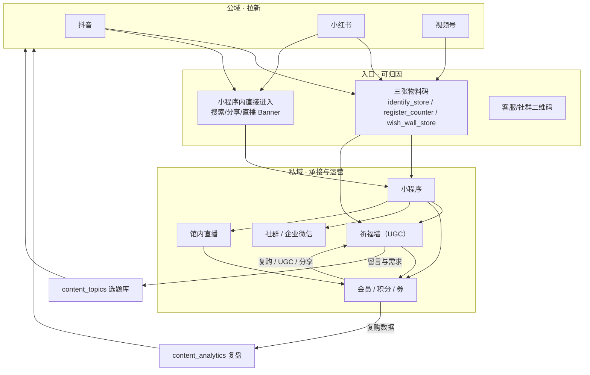

# 山海造物 · 内容体系 · 私域与转化闭环

> 版本 v1.0 · 2026-09-21 · **上位文件**：`docs/内容体系_总纲_三阶段路线图_2026-09-21.md`
> 覆盖：**引流入口 → 承接阵地 → 运营节拍 → UGC 引擎 → 会员复购 → 数据看板 → 复盘飞轮。**
>
> 本文件是内容体系的**终点与起点**：所有公域内容最终要落到「可触达的人」，
> 而私域里长出来的需求（留言、问题、复购）又要回流成新的选题。

---

## 1. 闭环总图



**一句话**：公域负责「被看见」，入口负责「被记住是谁带来的」，私域负责「被反复触达」，
UGC 负责「自己长出内容」，复盘负责「把前四件事变成下一轮的依据」。

---

## 2. 为什么私域是这套体系的「终点站」

公域的三个不可控：

| 不可控 | 后果 |
|-------|------|
| 平台规则变化 | 内容可能一夜限流/下架 |
| 算法不承诺触达 | 有粉丝也可能看不到你的内容 |
| 无法主动触达 | 只能等内容被推荐 |

**小程序私域的三个独有优势**（这些是本仓库已经建成的能力）：

| 优势 | 依赖的既有能力 |
|------|--------------|
| **可归因** | `entrySource` 全会话携带 + `qr_material_enter`（`docs/物料码埋点与转化监测_2026-09-20.md`） |
| **可主动触达** | 订阅通知（`docs/服务通知模板清单与注入步骤_2026-09-17.md`）、社群 |
| **闭环内成交** | 商品/购物车/支付/会员/券/积分全在小程序内 |

> ⚠️ **合规边界（必须先确认）**：用户从公域平台跳转到微信的**具体导流话术与路径**受各平台规则限制
> （总纲 §9 C1/C2）。本文件给出的是**结构**，具体话术必须等平台规则核实后定稿。

---

## 3. 入口盘点（每一条都要能归因）

### 3.1 三张已登记的物料码

| key | 物料 | 目标页 | 关键转化 | 码里 `scene` |
|-----|------|-------|---------|-------------|
| `qr:identify_store` | 门店 AI 识别码 | 标本工坊（AI 鉴定入口） | AI 鉴定 → 收藏/下单 | `identify_store` |
| `qr:register_counter` | 收银台注册码 | 注册礼券页 | 注册 → 用券成交 | `register_counter` |
| `qr:wish_wall_store` | 祈福墙立牌码 | 祈福墙 | 仪式 → 写愿 → 推荐 → 注册 → 成交 | `wish_wall_store` |

**口径要点（已核实）**：

- `key` **一旦发布不可改**（已印出去的码、已入库的 `entrySource` 都按它聚合）。
- `entrySource` 是**会话级覆盖**语义：同一会话先扫 A 再扫 B，A 之后的转化会被算成 B。
- **归因不靠 `qr_material_enter` 事件**，靠 `entrySource` 在所有事件上携带；
  `qr_material_enter` 只负责算漏斗第一环「扫码进入」。
- 历史数据**不可回溯**；`entrySource` 必须在云端字段白名单内（否则整条归因被静默丢弃，已有守卫拦）。

### 3.2 内容体系需要**新增**的入口（本规划的诉求）

| 入口 | 形态 | 用途 | 归因方式 |
|------|------|------|---------|
| 直播挂车 / 预约 | 小程序内 | 直播转化 | 会话级（天然） |
| 内容平台引导 | 抖音/小红书主页/评论区 | 公域→私域 | **新 key**（如 `qr:from_douyin` / `qr:from_xhs`），需按既有物料登记流程新增 |
| 门店立牌/桌卡 | 线下 | 到店转化 | 新 key |
| 礼笺/包装内卡片 | 随货 | 复购与养护 | **已有** `gift_print`（见 `docs/礼笺印刷码导流与兜底文案_2026-09-20.md`，码已改为纯黑以保证热敏可读） |
| 社群活码 | 企业微信/社群 | 私域承接 | 需确认是否纳入同一套归因 |

> ⚠️ **新增物料码是代码+印刷改动**：必须走既有登记流程（`entrySource` 白名单、`scene` 可解析、
> 侧车清单、守卫），**不能只在文档里写一个 key**。且**印刷品一旦发出不可回收**，
> key 设计前必须确认口径（总纲 §8 Q5 影响此项）。

### 3.3 各入口的「责任内容」

| 入口 | 它负责说什么 | 不负责什么 |
|------|------------|-----------|
| 门店 AI 识别码 | 「你手上这个是什么」→ 知识价值 | 不负责促销 |
| 收银台注册码 | 「注册能拿走什么」→ 权益 | 不负责科普 |
| 祈福墙立牌 | 「写一个愿」→ 情绪与参与 | 不负责成交（成交是结果不是目的，见 PRD 护栏） |
| 礼笺卡 | 「怎么养护 / 有问题找谁」 | 不负责二次推销 |
| 内容平台引导 | 「我们在微信里还有一间屋子」 | **不承诺平台上不允许承诺的东西** |

---

## 4. 承接阵地（三选一，必须先拍板）

> 总纲 §8 **Q5** 必须拍板：**企业微信 / 微信社群 / 仅小程序会员**。
> 三者的合规边界与可触达能力差异很大，混着做会同时踩三类坑。

### 4.1 三种阵地的对比

| 维度 | 企业微信 | 微信社群 | 仅小程序会员 |
|------|---------|---------|-------------|
| 可主动 1v1 触达 | ✅ 强 | ❌ 群发受限 | ⚠️ 仅订阅通知 |
| 可群触达 | ✅ | ✅ | ❌ |
| 运营成本 | 中（需人值守） | 高（要持续产出话题） | **低** |
| 合规风险 | 低（官方工具） | 中（群内容不可控） | **最低** |
| 数据归因 | 需打通 | 难 | **强（自有）** |
| 适合阶段 | 第二/三阶段 | 第三阶段 | **第一阶段** |

### 4.2 建议路线（**供拍板，非结论**）

| 阶段 | 承接阵地 | 理由 |
|------|---------|------|
| 第一阶段 | **仅小程序会员 + 订阅通知** | 成本最低、归因最强、不需要额外人力；先证明「内容能带人来」 |
| 第二阶段 | 加 **企业微信**（1–2 个号） | 有人可值守时再加，做 1v1 与养护答疑 |
| 第三阶段 | 视情况加 **社群** | 社群需要持续运营能力，没有内容产能支撑的社群会死 |

> **纪律：不要在没有产能的阶段开社群。** 一个 3 天没人说话的群，比没有群更伤信任。

---

## 5. 运营节拍（触达不能太密也不能太疏）

### 5.1 订阅通知（已有能力）

| 场景 | 触发 | 频率约束 |
|------|------|---------|
| 订单状态 | 支付/发货/自取 | 业务必需，不受内容节拍限制 |
| 开播提醒 | `live_reminders`（用户主动预约） | 每次开播一次（用户已授权） |
| 生日礼 | 生日礼配置（`admin/docs/生日礼配置_Phase1.md`） | 每年一次 |
| 内容/活动 | **需确认是否已有模板** | ⚠️ 待确认（总纲联动） |

> ⚠️ **订阅通知是「一次性授权」**，用一次少一次。**不要拿它推内容**——
> 留给真正重要的（开播、订单、生日）。内容推送应走社群/公众号（若有）。

### 5.2 内容在私域里的节拍（第一阶段）

| 渠道 | 频率 | 内容 |
|------|------|------|
| 小程序社区 | 2–3 条/周 | 工艺/养护/博物小课（复用公域母素材的横屏版） |
| 祈福墙 | 持续 | UGC，不排产（用户产出） |
| 直播 | 第一阶段 4 场 | 见直播文件 |
| 会员/积分 | 按既有规则 | 不做额外改动 |

---

## 6. UGC 引擎：祈福墙

**祈福墙是本体系里唯一「用户自己生产内容」的地方**，也是私域内容成本的解法。
其产品定位与护栏**以 `docs/祈福墙_PRD_v1_2026-09-20.md` 为唯一事实源**，本文件只讲运营侧的接入方式。

### 6.1 北极星与漏斗（**引用 PRD，不自创**）

- **北极星**：**扫码 → 成交**（不是注册数，也不是上墙条数）。
- 漏斗：扫码进页 → 完成一个仪式动作（点灯/木鱼） → 写一条心愿 → 抽一次玩法 → 点推荐 → 注册 → 用券成交。
- **护栏（不许为了漏斗数字牺牲）**：
  - 不许一进页就弹注册（打断「驻足」这个动作本身）；
  - 不许编造社会证明/运势承诺（合规口径：「文化娱乐向、不涉命理改运」）；
  - 推荐失败**不得阻断**玩法。

### 6.2 内容体系如何为祈福墙供料

| 内容侧动作 | 目的 |
|-----------|------|
| 拍摄「写愿签的手」「灯亮起来」「木鱼与寂静」 | 为祈福墙提供**线下→线上的视觉桥梁**（P4 主脉） |
| 把祈福墙的真实心愿（脱敏后）做成内容 | 让线上的人看到「别人也在写」→ 社会证明的**合法形态**（真实的，不是编造的） |
| 直播里朗读当周心愿（需作者授权） | 把 UGC 变成直播素材 |

> ⚠️ **红线**：用户心愿属于用户内容，**引用必须脱敏并取得授权**；
> 且**不得编造**心愿（PRD 护栏明令禁止编造社会证明）。

### 6.3 木鱼不做逐次埋点（**刻意设计，不要"补全"**）

`onMuyuTap` 体内**一次云端写/上报都不许有**（写放大防护），有守卫守着。
计数通过 H1「连续记录云保存」在离开页面时上报一次。
→ **不要为了「补全漏斗」往 `onMuyuTap` 里加 `trackBehavior`**，那会同时破坏一条刻意设计与一条守卫。

---

## 7. 会员与复购

### 7.1 复购的三个自然触发点

| 触发点 | 依托能力 | 运营动作 |
|-------|---------|---------|
| **养护周期** | `PRD_标本养护`、养护指南 | 到期提醒「该检查湿度了」（对应 `getCareGuides` / `getCareSpecimens`） |
| **仪式感节点** | `docs/仪式感与彩蛋机制_长线框架_2026-09-16.md` | 生日礼、纪念日、节日 |
| **内容钩子** | 内容里出现的品类 | 内容→商品页（**不做伪装成内容的硬广**） |

### 7.2 新客首单

沿用既有口径：**新客礼包 99-10 券 + 停发 100 积分**（`docs/新客礼包口径变更_99减10券_2026-09-17.md`），
且注意「**必须保存一次配置才生效**」这条已记录的历史坑。

### 7.3 复购的口径纪律

- 复购率的口径以既有后台统计为准（`admin/docs/` 与 `docs/商品销量展示口径_2026-09-18.md`）；
- **不要把「内容带来的复购」和「自然复购」混算**——除非有归因链路（`entrySource`）支撑；
- 内容侧唯一要负责的是**把可归因的入口铺好**，而不是替复购记账。

---

## 8. 数据看板与周报

### 8.1 看板分三层

| 层级 | 看什么 | 在哪看 | 频率 |
|------|-------|-------|------|
| **内容层** | 每条成品的 `metrics` | 内容工厂「复盘」Tab + `content_analytics` | 周 |
| **入口层** | 三张物料码的扫码→转化漏斗 | 埋点报表（`docs/物料码埋点与转化监测_2026-09-20.md` §3） | 周 |
| **私域层** | 注册净增、会员净增、直播数据 | 后台统计 + ERP 直播管理 | 周/月 |

### 8.2 周报模板（30 分钟出）

```markdown
# 内容周报 · 2026-W__（__月__日 – __月__日）

## 1. 产量
| 平台 | 发布数 | 达标（≥3） | 未发原因 |
|------|-------|-----------|---------|
| 抖音 | | | |
| 小红书 | | | |
| 视频号 | | | |
| 小程序社区 | | | |

## 2. 内容工厂状态
- `content_assets` 新增：__ 条（拍摄日 __ 次）
- `content_pieces` published 累计：__
- `review` 堆积：__ 条（>14 天自动归档：__ 条）

## 3. 入口转化（只填能测的）
| 码 | 扫码进入 | 关键转化 | 备注 |
|----|---------|---------|------|
| identify_store | | | |
| register_counter | | | |
| wish_wall_store | | | |

## 4. 私域
- 注册净增：__（可归因 __）
- 会员净增：__
- 直播：__ 场，峰值 __，留言 __

## 5. 本周信号
- 表现最好的 1 条：____（为什么：____）
- 表现最差的 1 条：____（为什么：____）

## 6. stopList（下周不做）
-

## 7. 下周片单（3–5 条选题）
1.
```

### 8.3 月报（复盘飞轮的正式产物）

每月一次，产出**一条 `content_analytics`**，必须包含：

| 字段 | 要求 |
|------|------|
| `period` | `2026-W__` 或 `2026-__` |
| `inputMetricsSummary` | 上表的汇总数字 |
| `insights` | **必须是可证伪的句子**（「工艺类完播率高」→ 错；「工艺类里『切角』主题完播率比『封背』高 X%」→ 对） |
| `nextTopics` | ≥ 5 条，**必须真的进 `content_topics` 并被打出来** |
| `stopList` | 明确要停的类型 |

> **飞轮成立的定义**：复盘产出的 `nextTopics` **真的进入排产并被拍出来**。
> 只写不排 = 飞轮空转（第二阶段闸口 2 会检查这一点）。

---

## 9. 诚实边界（哪些事现在做不到）

| 想做的事 | 现状 | 不能假装 |
|---------|------|---------|
| 精确统计直播观看 UV | `presence` 是 heartbeat 的**近似值** | ❌ 不要当精确 UV 写进报告 |
| 公域平台的完整转化归因 | 平台不给 | ❌ 只能看平台自身数据 + 私域侧的 `entrySource` |
| 同会话多次扫码各自成环 | `entrySource` 是会话级覆盖 | ❌ 需改成扫码级 short-id（**未做**） |
| 历史数据回溯 | 埋点是后加的 | ❌ 历史不可回溯 |
| 内容带来的复购 vs 自然复购 | 无归因链路 | ❌ 不要混算 |
| 直播挂车点击 | 取决于是否有埋点 | ❓ 待确认 |

**纪律（E16）**：凡标 ❌/❓ 的，**不得在复盘里当结论使用**。测不了就写「不可测」。

---

## 10. 待确认项

| # | 问题 | 关联 |
|---|------|------|
| P1 | 私域承接主阵地选哪个（企业微信/社群/仅会员） | 总纲 Q5 |
| P2 | 内容平台→私域的合规导流话术（平台规则核实后定稿） | 总纲 C1/C2 |
| P3 | 是否新增内容平台来源的物料码（key 命名与印刷计划） | §3.2 |
| P4 | 订阅通知现有模板清单（能否用于内容/活动） | §5.1 |
| P5 | 直播挂车点击/成交是否有埋点 | 直播文件 L5 |
| P6 | 社区内容是否有新的发布入口（ERP/小程序侧） | §5.2 |
| P7 | 祈福墙心愿的引用授权流程由谁执行 | §6.2 |

---

## 11. 变更记录

| 日期 | 变更 | 作者 |
|------|------|------|
| 2026-09-21 | 首版：闭环总图、入口盘点、承接阵地对比、运营节拍、UGC 接入、看板与周报、诚实边界 | 施工方 |
