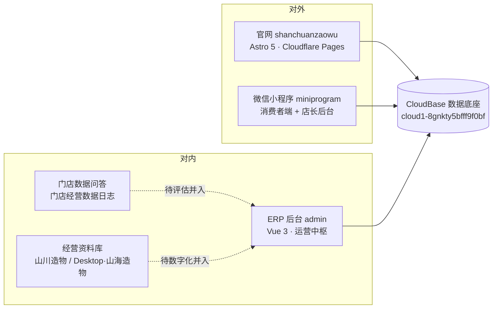

# 山海造物 · 项目总览与后续工作框架

> 版本 v1.0 · 2026-08-10 · 供业务方、开发与 AI 协作者对齐
> 编写依据：`LIFEOS-002_接管与模块排期.md`、`shanchuanzaowu/docs/monorepo.md`、`docs/PLATFORM_CAPABILITIES.md`、`admin/docs/内容工厂_Phase1_技术蓝图.md` 及五处工作区实盘盘点
> 本文件为**总览与框架**，不替代各仓库已有技术文档；具体细节以文末「附录：关键索引」为准。

---

## 1. 业务线全景：五端 + 一底座

山海造物是一条**「线上内容 + 线下门店 + 标本藏品」**的业务线，数字产品由五端构成，共用同一个云数据底座：



| 端 | 位置 | 技术 | 状态 |
|----|------|------|------|
| 官网 | `shanchuanzaowu/src/` | Astro 5 + Tailwind v3 + TS | v0.4 双主题（日间/夜间博物馆），生产部署中 |
| ERP 后台 | `shanchuanzaowu/admin/` | Vue 3 + Element Plus + rolldown-vite | 运营中枢，内容工厂 Phase 1 已部分落地 |
| 微信小程序 | `shanchuanzaowu/miniprogram/` | 原生小程序 + 云函数 | 消费者端 + 店长后台，与 ERP 同云环境 |
| 云底座 | CloudBase（上海） | `@cloudbase/js-sdk` | 三端共享集合与权限规则 |
| 经营资料库 | `山川造物/`、`Desktop/山海造物/` | 财务模型 / 协议 / 运营文档 | 散件待数字化，需求并入 ERP |
| 门店数据问答 | `门店经营数据日志/` | FastAPI + llama_index + Ollama | 本地原型（开发中），待评估并入后台数据模块 |

---

## 2. 仓库角色与主库判定（重要）

> **结论：`shanchuanzaowu`（monorepo）是当前唯一代码主库；`shanchuan-admin` 降级为历史归档副本。**

| 仓库 | 角色 | 依据 |
|------|------|------|
| `shanchuanzaowu` | **代码主库**（官网 + ERP + 小程序 + 云配置同仓） | `docs/monorepo.md` 明确「后续以本 monorepo 为准」；`admin/` 含内容工厂、`contentDb.js`、`storeLedgerSync.js` 等最新代码 |
| `shanchuan-admin` | 历史副本 / 文档归档 | 代码落后（缺内容工厂等模块），但 `docs/LIFEOS-002` 等新文档尚未同步至 monorepo |
| `山川造物` | 企业资料库（财务/法务/协议） | 运营中，无代码 |
| `门店经营数据日志` | 本地知识 API 原型 | 开发中 |
| `Desktop/山海造物` | 运营与商业文档库（已按 01–13 分类归档） | 运营中 |

**分叉现状（已核实）**：

- `shanchuanzaowu/admin/` 领先 `shanchuan-admin/`：新增 `ContentFactory.vue`、`contentDb.js`、`contentMetrics.js`、`cloudbaseCdnDb.js`、`embeddedPageUrl.js`、`portraitDataLoad.js`、`storeLedgerSync.js` 等；`App.vue`、`cloud.js`、`aiHelper.js`、`modulesRegistry.js` 均有差异。
- `shanchuan-admin/` 领先 monorepo：`docs/LIFEOS-002_接管与模块排期.md`（2026-06-16）未同步。

**同步规则**：今后代码与文档改动一律在 monorepo 进行；`shanchuan-admin` 只读归档，确需回灌时单向复制并提交说明。

---

## 3. 三端现状速览

### 3.1 官网（Astro）
- 版本 v0.4，双主题自适应（系统偏好 → localStorage → 手动覆写）。
- 主要路由：`/`、`/what`、`/who`、`/why`、`/how`（含 `/how/senses`、`/how/space`、`/how/operations`、`/how/tech`）、`/foundation`、`/for-properties`、`/for-franchise`、`/for-investors`、`/talent`、`/notes`、`/benchmarks`、`/digital-ops`、`/hardcore-tech`、`/sound-manual`。
- 当前有未提交改动（`Header.astro`、`price-list.astro`、`global.css` 等，截至 2026-08-10），上线前需确认。

### 3.2 ERP 后台（Vue 3）
- 无独立路由文件：侧栏菜单 `currentTab` → 组件映射全部在 `App.vue`（约 60 个业务组件 + `ai/` 场景子模块）。
- 模块覆盖：经营驾驶舱、藏品档案、财务核算、全渠道订单、会员 CRM、活动营销、内容管理、AI 智能中心、小程序配置类（首页/会员等级/积分/预约/营销规则/通知/搜索推荐/成就/行为追踪）、数据报表、实时监控等。
- **内容工厂（最新进展）**：Phase 1 已按蓝图落地模块与 CloudBase 数据层（选题 → 文案/脚本 → 终审 → 发布登记 → 复盘），详见 `admin/docs/内容工厂_Phase1_技术蓝图.md`。

### 3.3 小程序（微信）
- AppID `wxf2550373b010b447`；消费者端 + 店长后台；云函数位于 `miniprogram/cloudfunctions/`。
- 与 Web 数据同步：店长账本 `store_ledger`，`syncFinanceData` 云函数双向同步 `finance_records`（**该云函数仍需在微信开发者工具上传部署**）。

---

## 4. 数据底座（CloudBase）

- 环境：`cloud1-8gnkty5bfff9f0bf`（ap-shanghai）；Web 端匿名登录 + 安全域名白名单。
- 集合治理三件套：`src/cloud.js` 的 `COLLECTIONS` 常量 ↔ `cloudbase/rules/*.json` 权限 ↔ `cloudbase/schema/*.md` 结构说明，**新增集合需三处同步**。
- 关键业务集合：`products`、`orders`、`users`、`finance_records`、`store_ledger`、`content_*`（内容工厂）、`home_configs`、`member_levels`、`marketing_rules_config` 等（完整清单见 `docs/DATABASE_CONNECTION.md` 与 `shanchuanzaowu/docs/cloudbase-collections.md`）。

---

## 5. 当前工作流与模块排期

### 5.1 迭代工作流（建议固化）
任务卡（LIFEOS-xxx）→ 需求方拍板优先级（Jobs）→ PRD/蓝图（`docs/`）→ 实现（monorepo）→ 验证（dev + build）→ 部署（Pages / 小程序上传）→ 复盘记录（docs 说明文档）。

### 5.2 模块排期（LIFEOS-002，待 Jobs 最终拍板）
1. **店铺管理**（连锁经营的数据根节点，其余模块依赖它）→ 2. **员工薪酬**（直接关系发钱）→ 3. **加盟商管理**（依赖店铺数据成型）。
- 内容工厂 Phase 1 为当前进行中项；Phase 2/3（自动发布、视频切片、数字人）均明确不做或待评估。

### 5.3 待办清单（截至 2026-08-10）
- [ ] 将 `LIFEOS-002` 与本文档同步进 monorepo
- [ ] Jobs 拍板模块优先级 → Linus 排期
- [ ] 部署 `syncFinanceData` 云函数（微信开发者工具）
- [ ] 业务线数据打通方案草案（官网/ERP/小程序对齐 CloudBase）
- [ ] 门店数据问答（FastAPI 原型）作为后台数据模块的评估
- [ ] 经营资料数字化并入 ERP（山川造物 / Desktop 散件）
- [ ] 遗留物处置：根目录 `Mountain_River_Ultimate_V17_Final.html` 退役（需 Hayden 确认）、`.env` 真实凭据交接

---

## 6. 后续工作框架（协作规则）

### 6.1 代码改动一律进 monorepo
- 官网改 `shanchuanzaowu/src/`；ERP 改 `shanchuanzaowu/admin/`；小程序改 `shanchuanzaowu/miniprogram/`。
- `shanchuan-admin` 为归档副本，不做代码修改；需要时单向同步并留记录。

### 6.2 运行命令速查
```bash
# monorepo（shanchuanzaowu）
npm install
npm run dev           # 官网 http://localhost:4321
npm run dev:admin     # ERP http://localhost:5178
npm run build         # 完整构建（ERP → dist/admin/ + 官网 → dist/）
# 小程序：微信开发者工具打开 miniprogram/ 目录
```

### 6.3 文档约定
- 新模块先落 PRD/蓝图文档，再动代码；模块上线后补充「说明文档」并登记到 `docs/README.md` 索引。
- 供 AI 协作者阅读的唯一入口保持更新：monorepo `AGENTS.md` → 本文档 → 各端 `docs/`。

### 6.4 数据约定
- 新增云集合三处同步：`cloud.js COLLECTIONS` + `cloudbase/rules/` + `cloudbase/schema/`。
- 权限以 CloudBase 安全规则为准；Admin 口令不等于行级权限（演示与生产边界见 `PLATFORM_CAPABILITIES.md` §9）。

### 6.5 交付与发布
- 官网/ERP：合并到 `main` → GitHub Actions 自动构建部署 Cloudflare Pages（`deploy-pages.yml`）。
- 小程序：微信开发者工具上传（不走 Pages）。
- 版本号以 `package.json` 与 git 为准，界面展示版本号仅供参考。

---

## 7. 附录：关键索引

| 事项 | 位置 |
|------|------|
| 业务线接管与排期 |
| 下一阶段工作重点 | `docs/工作重点_估值_合伙人_投融资_股权架构.md`（估值/合伙人/投融资/股权架构，W1–W4 框架） |
 `shanchuan-admin/docs/LIFEOS-002_接管与模块排期.md` |
| 平台能力总览 | `docs/PLATFORM_CAPABILITIES.md` |
| monorepo 结构 | `shanchuanzaowu/docs/monorepo.md` |
| CloudBase 初始化清单 | `shanchuanzaowu/docs/cloudbase-collections.md`、`cloudbase-collections.md` |
| 财务多端同步 | `docs/财务数据多端同步说明.md`、`shanchuanzaowu/docs/admin-a1-cloudbase.md` |
| 内容工厂蓝图 | `shanchuanzaowu/admin/docs/内容工厂_Phase1_技术蓝图.md` |
| 模块 PRD | `docs/PRD-三期规划.md`、`PRD-店铺管理模块.md`、`PRD-员工薪酬管理模块.md`、`PRD-加盟商管理模块.md` |
| AI 架构 | `docs/AI_SYSTEM_ARCHITECTURE.md`、`docs/AI功能升级说明.md` |
| 小程序说明 | `shanchuanzaowu/miniprogram/README.md` |
| 门店数据原型 | `门店经营数据日志/main.py`（FastAPI + Ollama） |
| 经营资料库 | `山川造物/`（财务/法务）、`Desktop/山海造物/`（运营/商业文档） |
