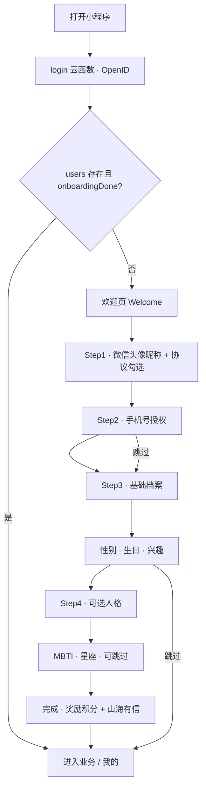

# 会员账号与个人中心 PRD

> **文档状态**：v0.1（共创稿）  
> **模块代号**：Member Identity / 藏家档案  
> **品牌**：山海造物 Nature's Creations · Museum Mode（C 端）  
> **撰写日期**：2026-05-23  
> **共创说明**：文中 **【待确认】** 须产品 / 运营 / 法务 / 技术共同拍板后方可开发。

---

## 1. 文档信息

| 项 | 内容 |
|---|---|
| 产品模块 | 注册登录、手机号绑定、个人信息完善、个人主页升级、会员卡交互 |
| C 端入口 | 全局静默登录 → **引导/onboarding** → 「我的」Tab（`pages/user/index`）→ **个人资料页**（新增） |
| 关联页面 | `pages/user/index`（我的）、`pages/user/profile/index`（新增）、`pages/user/onboarding/index`（新增） |
| 关联云函数 | `login`（已有）、`getUserStats`（已有）、`earnPoints`（已有）；新增 `authPhone`、`upsertUserProfile`、`getMemberPass` |
| 关联集合 | `users`（扩展字段）、`user_checkins`（已有签到）、`member_pass_tokens`（新增，会员码） |
| 前置文档 | [产品功能现状梳理](./产品功能现状梳理.md)、[PRD_二期优化](./PRD_二期优化.md)、[PRD_三期规划](./PRD_三期规划.md)、Design System（`.cursorrules`） |

---

## 2. 背景与问题陈述

### 2.1 业务诉求

山海造物 C 端已具备 **OpenID 静默登录、会员卡展示、签到、等级成长值、会员码弹窗** 等基础能力，但账号体系仍停留在「微信匿名访客 + 可选昵称头像」阶段，难以支撑：

| 诉求 | 说明 |
|---|---|
| **可识别的藏家** | 门店核销、生日礼遇、专属推荐需要稳定用户 ID 与联系方式 |
| **合规触达** | 订单/预约/养护提醒等需要手机号作为备用触达 **【待确认：是否强制】** |
| **个性化体验** | 兴趣标签、品类偏好可用于首页推荐、社区、鉴定引导 |
| **会员运营闭环** | 会员卡不应只是展示，而应成为 **到店凭证 + 权益入口 + 成长反馈** |
| **品牌情感连接** | MBTI、星座、生日等轻量人格信息符合「朋友式分享」调性，可用于策展文案与活动分群 |

### 2.2 现状诊断（基于代码）

| 能力 | 现状 | 问题 |
|---|---|---|
| **登录** | `app.js` 启动时调 `login` 云函数取 OpenID | 无显式登录态 UI；用户感知为「未登录用户」 |
| **注册** | 首次 `updateUserProfile` 时 `users.add` | 无注册完成概念；无欢迎/onboarding |
| **手机号** | 未接入 `getPhoneNumber` / 短信 | 用户档案无 phone；下单地址 phone 与账号未关联 |
| **头像** | `chooseAvatar` + 临时路径展示 | **未上传云存储**，换机/重装丢失 |
| **昵称** | 会员卡内 `input type=nickname` | 编辑入口隐蔽；无独立资料页 |
| **扩展资料** | `users` 无 gender / birthday / interests 等字段 | 生日礼遇、分群、推荐无法落地 |
| **资料完整度** | 无 `profileComplete` / 引导 | 高价值操作（下单、发布、预约）无统一门槛策略 |
| **会员码** | 外链 QR `api.qrserver.com` + 明文 OpenID | 隐私与稳定性风险；门店难校验时效 |
| **会员卡交互** | 陀螺仪光效 + 签到 + 会员码弹窗 | 缺升级动效、权益故事化、到店扫码联动 |
| **个人主页** | 功能入口聚合丰富 | 缺「我的档案」摘要、兴趣外露、资料完成进度 |

**结论**：本 PRD 目标 = **建立「微信 + 手机号」双轨身份** + **分步资料完善（含兴趣/MBTI/星座/生日）** + **个人主页与会员卡体验升级**。

---

## 3. 产品定位

### 3.1 一句话定位

> **藏家档案 = 走进山海造物时的「铜牌身份」—— 微信让你进来，手机号让你被找到，兴趣与生日让你被懂得；会员卡是随身携带的馆藏通行证。**

### 3.2 与相邻能力分工

| 能力 | 定位 | 与本模块关系 |
|---|---|---|
| **OpenID 静默登录** | 设备级身份 | 保留为底层；用户无感完成 |
| **手机号绑定** | 账号级身份 | 注册/onboarding 关键步；与地址 phone 可合并展示 |
| **会员等级（getUserStats）** | 消费驱动的 Lv1–5 | 资料完善可给 **一次性成长值/积分** 奖励，不替代消费升级 |
| **签到（earnPoints）** | 日活激励 | onboarding 完成后解锁完整签到反馈 copy |
| **山海有信** | 消息触达 | 资料完善奖励、生日礼遇、等级升级写入站内信 |
| **门店签到（storeCheckIn）** | 到店行为 | 与会员码扫码核销联动 **【待确认】** |

### 3.3 北极星指标

| 指标 | 说明 | M1 目标 **【待确认】** |
|---|---|---|
| **注册转化率** | 进入 onboarding 并完成核心步（手机+昵称）/ 触发 onboarding 用户 | ≥ 60% |
| **资料完整度** | 至少填写生日+1 项兴趣的用户占比 | ≥ 40%（90 日内） |
| **手机号绑定率** | 有 phone 的 users / 活跃 users | ≥ 50% |
| **会员码出示率** | 展示会员码 UV / 我的页 UV | 较基线 +30% |
| **生日礼遇触达成功率** | 生日前 7 日写入站内信且用户已填 birthday | ≥ 95% |

---

## 4. 设计原则

1. **Silent First, Explicit When Needed** — 打开小程序即完成 OpenID 登录；仅在需要身份/触达/权益时引导手机号与资料。
2. **Progressive Profiling** — 分步收集：先「能用的身份」（手机、昵称、头像），再「更好懂的偏好」（兴趣、生日），最后「可选的自我描述」（MBTI、星座）。
3. **Museum Card, Not SaaS Form** — 表单视觉遵循 Museum Mode：深色底、黄铜强调、铜牌式摘要卡；避免问卷感长表单。
4. **Skip with Grace** — 每步可跳过；跳过后在「我的」显示完成度条，不阻断浏览。
5. **Value Exchange** — 完善资料给予可感知回报（积分/成长值/券）；文案写清「为何需要」。
6. **Privacy by Design** — 手机号脱敏展示；MBTI/星座默认仅自己可见，社区展示需二次授权 **【待确认】**。
7. **No Emoji Icons** — 与 Design System 一致，使用线性图标。

---

## 5. 用户角色与核心故事

### 5.1 C 端用户

| ID | 故事 | 验收 |
|---|---|---|
| U1 | 作为新用户，我希望首次进入时被温和欢迎，并用微信快速完成基础身份 | 静默 OpenID 成功 → 欢迎页 → 可选授权头像昵称 |
| U2 | 作为买家，我希望绑定手机号以便接收订单与预约通知 | 一键微信手机号 → 云函数解密入库 → 脱敏展示 |
| U3 | 作为藏家，我希望填写生日以便收到生日礼遇 | 生日选择器 → 保存 → 站内信/礼遇策略可读取 |
| U4 | 作为自然爱好者，我希望选择兴趣（昆虫/矿物/植物/海洋等）以获得更准推荐 | 兴趣多选 → 写入 users.interests → 推荐接口可读 |
| U5 | 作为用户，我希望可选填 MBTI、星座，让个人主页更有「档案感」 | 资料页可选填；主页展示摘要 |
| U6 | 作为会员，我希望会员卡清晰展示等级、进度，升级时有反馈 | 进度条 + 升级动效 + 山海有信通知 |
| U7 | 作为到店用户，我希望出示会员码供门店扫码识别 | 小程序内动态码 + 门店端校验 **【待确认】** |
| U8 | 作为老用户，我希望在「我的」看到资料完成度并一键补全 | 完成度条 + 跳转资料页 |

### 5.2 运营 / 门店

| ID | 故事 | 验收 |
|---|---|---|
| O1 | 作为运营，我希望按兴趣/生日/等级分群推送 | ERP/店长后台可读 users 标签 **【待确认：M1 仅只读】** |
| O2 | 作为店员，我希望扫码识别会员并记录到店 | storeCheckIn 与 member pass 打通 **【待确认】** |

---

## 6. 注册与登录路径

### 6.1 身份模型

```
┌─────────────────────────────────────────────────────────┐
│  Layer 1 · 设备身份（静默）                               │
│  wx.login → cloud login → OPENID                         │
│  状态：guest（仅有 openid，无 users 文档或 profile 为空）   │
├─────────────────────────────────────────────────────────┤
│  Layer 2 · 微信资料（轻注册）                             │
│  chooseAvatar + nickname + 同意《用户协议》《隐私政策》     │
│  状态：registered（nickName + avatarUrl 已持久化）        │
├─────────────────────────────────────────────────────────┤
│  Layer 3 · 手机绑定（强身份）                             │
│  getPhoneNumber → authPhone 云函数                        │
│  状态：verified_phone（phone 已绑定，唯一性校验）           │
├─────────────────────────────────────────────────────────┤
│  Layer 4 · 藏家档案（完善）                               │
│  gender / birthday / interests / mbti / zodiac …         │
│  状态：profile_enriched（profileScore ≥ 阈值）            │
└─────────────────────────────────────────────────────────┘
```

### 6.2 触发 onboarding 的时机 **【待确认】**

| 策略 | 说明 | 建议 |
|---|---|---|
| **A. 首次进入「我的」** | 无 users 或 `onboardingDone !== true` | ✅ M1 默认 |
| **B. 首次高价值操作前** | 下单、预约、社区发布、领券 | ✅ M1 与 A 组合：弹层引导，可「稍后」 |
| **C. 冷启动全局拦截** | 打开小程序即全屏 onboarding | ❌ 不推荐，伤害浏览转化 |

**M1 决策建议**：A + B；浏览不拦截，交易/发布拦截 Layer 2/3。

### 6.3 流程图（M1）



### 6.4 Step 说明

#### Step 0 · 静默登录（已有，增强）

- 启动 `app.js` → `login`；失败重试 3 次，写入 `globalData.authError`。
- 新增：`syncUserSession` 云函数或客户端封装 — 拉取 users + 计算 `authState`（guest / registered / verified_phone / enriched）。

#### Step 1 · 欢迎与微信资料

| 元素 | 说明 |
|---|---|
| 视觉 | 深色博物馆入口；品牌名宋体 + Tagline「把山海带回家」 |
| 操作 | `chooseAvatar`、`input type=nickname` |
| 协议 | 勾选《用户服务协议》《隐私政策》（链接已有 about/法务页 **【待确认 URL】**） |
| 提交 | `upsertUserProfile`；写入 `registerSource: 'wechat_mp'`、`registerTime` |

#### Step 2 · 手机号绑定

| 元素 | 说明 |
|---|---|
| 组件 | `button open-type="getPhoneNumber"` |
| 后端 | 新云函数 `authPhone`：解密 phone → 唯一性校验 → 写入 `users.phone`、`phoneVerifiedAt` |
| 冲突 | 若 phone 已绑定其他 openid → 提示联系专员，不自动合并 **【待确认：是否支持申诉合并】** |
| 跳过 | 允许跳过；下单/预约时再次强引导 |

#### Step 3 · 基础档案（核心完善）

| 字段 | 类型 | 必填 | 说明 |
|---|---|---|---|
| `gender` | enum | 否 | `male` / `female` / `other` / `prefer_not`；文案：男/女/其他/不愿透露 |
| `birthday` | string | 否 **【待确认：生日礼遇是否必填】** | `YYYY-MM-DD`；仅年月日，不含精确时辰 |
| `interests` | string[] | 否 | 见 §7.2 兴趣枚举；最多 5 项 |
| `city` | string | 否 | M2；省市区选择器 **【待确认 M1 是否包含】** |

#### Step 4 · 可选人格（可整步跳过）

| 字段 | 类型 | 说明 |
|---|---|---|
| `mbti` | enum | 16 型 + `unknown`；卡片点选 4 维或结果页直接选 |
| `zodiac` | enum | 12 星座；**可由 birthday 自动推算**，允许用户覆盖 |
| `bio` | string | 一句话介绍，≤ 40 字；社区展示用 **【待确认】** |

#### 完成页

- 展示「藏家编号」`memberNo`（已有 MT-xxxx 规则）。
- 奖励：**+50 积分** + **+20 成长值**（一次性，`profileRewardClaimed` 防重复）**【待确认数值】**。
- 写入山海有信：`profile_complete` 类型消息。
- 设置 `onboardingDone: true`、`onboardingDoneAt`。

### 6.5 登录态与退出

| 场景 | 行为 |
|---|---|
| 再次进入 | OpenID 自动识别，不重复 onboarding |
| 换绑手机 | 资料页发起；需新号 `getPhoneNumber`；旧号解绑写日志 |
| 退出登录 | 小程序**不提供** OpenID 级退出（微信约束）；仅「清除本地缓存」+ 展示 guest UI **【待确认是否需要】** |
| 账号注销 | 合规要求独立入口；软删除 users +  anonymize **【待确认：M2 法务流程】** |

---

## 7. 数据模型

### 7.1 `users` 集合扩展

```javascript
{
  _openid: string,
  // —— 已有 / 保留 ——
  nickName: string,
  avatarUrl: string,        // 云存储 fileID
  isAdmin: boolean,
  isHonorary: boolean,
  bonusPoints: number,
  usedPoints: number,
  createTime: Date,

  // —— Layer 2/3 新增 ——
  phone: string,              // 完整号仅存服务端；客户端脱敏
  phoneHash: string,          // 查重索引 **【待确认】**
  phoneVerifiedAt: Date,
  registerSource: 'wechat_mp' | 'store_qr' | 'campaign',
  registerTime: Date,
  onboardingDone: boolean,
  onboardingDoneAt: Date,
  onboardingStep: number,     // 断点续填

  // —— 藏家档案 ——
  gender: 'male'|'female'|'other'|'prefer_not'|'',
  birthday: '1990-05-20',     // 不含时间
  birthdayMonthDay: '05-20',  // 便于生日礼遇查询
  interests: ['INSECTA','MINERALS'],
  mbti: 'INFP' | '',
  zodiac: 'taurus' | '',      // 英文 key
  bio: string,
  city: string,

  // —— 完整度与奖励 ——
  profileScore: number,       // 0–100，见 §7.3
  profileRewardClaimed: boolean,

  // —— 隐私 ——
  privacy: {
    showMbti: boolean,        // 默认 false
    showZodiac: boolean,
    showBirthday: boolean       // 默认 false，仅月日祝福
  },

  updateTime: Date
}
```

### 7.2 兴趣枚举（与品类色对齐）

| key | 中文 | 关联品类色 |
|---|---|---|
| `INSECTA` | 神奇昆虫 | #52B788 |
| `MINERALS` | 群山回响 | #7B68AE |
| `PLANTAE` | 植物探微 | #6DA34D |
| `MARINE` | 无尽海洋 | #5B8FB9 |
| `FRAMING` | 装裱艺术 | 黄铜 |
| `CUSTOM` | 标本定制 | 黄铜 |
| `COURSE` | 自然课程 | — |
| `COLLECTING` | 收藏鉴赏 | — |

### 7.3 资料完整度计分 **【待确认权重】**

| 项 | 分值 |
|---|---|
| 头像（云存储） | 15 |
| 昵称 | 10 |
| 手机号 | 25 |
| 生日 | 15 |
| 兴趣 ≥1 | 15 |
| 性别 | 5 |
| MBTI | 8 |
| 星座 | 7 |
| **合计** | 100 |

- `profileScore >= 60` → 视为「基本完善」，生日礼遇生效。
- `profileScore >= 85` → 「藏家档案」徽章 **【待确认】**。

### 7.4 会员码 `member_pass_tokens`（新增）

```javascript
{
  openid: string,
  token: string,           // 随机 UUID，短期有效
  expiresAt: Date,         // 建议 60s 滑动刷新
  createdAt: Date
}
```

- 客户端每 60s 或打开会员码弹窗时 `getMemberPass` 刷新。
- 二维码内容：`shanchuan://member?token=xxx` 或 JSON **【待确认门店扫码方案】**。
- **废弃** 外链 `api.qrserver.com` + 明文 OpenID。

---

## 8. 个人主页（「我的」）升级

### 8.1 信息架构（M1）

```
我的 (pages/user/index)
├── 会员卡（升级 · 见 §9）
├── 藏家档案条（新增）
│   ├── 完成度环 / 进度条
│   ├── 兴趣标签外露（最多 3 个）
│   └── 「编辑资料 →」→ pages/user/profile/index
├── 个人资产 4 宫格（保留）
├── 我的数据（保留，可联动 profileScore）
├── 藏品订单矩阵（保留）
├── 馆藏服务列表（保留）
└── …
```

### 8.2 新增「个人资料页」`pages/user/profile/index`

| 区块 | 内容 |
|---|---|
| 头部摘要 | 头像、昵称、memberNo、等级 pill |
| 基础信息 | 手机（脱敏/换绑）、性别、生日 |
| 偏好 | 兴趣多选 Chip |
| 自我描述 | MBTI 选择器、星座（可跟随生日）、bio |
| 隐私设置 | 各项是否公开展示 |
| 账户 | 协议、注销入口（M2） |

**交互**：分区块保存或底部统一保存；保存成功 toast + 更新 profileScore。

### 8.3 视觉规范

- Museum Mode：卡片 `#1F1D1A`、边框 `#26232066`、CTA 黄铜 `#C4A76C`。
- 资料页标题区复用 care 模块 `care-header` 模式。
- 兴趣 Chip 使用品类色 18% 透明底。

### 8.4 与现有能力联动

| 联动 | 说明 |
|---|---|
| 社区发布 | 展示 nickName + avatar；可选展示 mbti 标签 |
| 确认订单 | 若未绑手机，结算前弹层引导 |
| 预约 | contactPhone 默认带入 users.phone |
| 推荐 | `getRecommendations` 可读 interests **【待确认 M1 是否改推荐逻辑】** |
| 成就 | 新增成就「完善藏家档案」「绑定手机号」 |

---

## 9. 会员卡交互升级

### 9.1 现状问题

- 光效依赖陀螺仪，部分机型不支持或耗电。
- 昵称编辑在卡内，易误触；头像未持久化。
- 会员码外链生成，OpenID 暴露。
- 权益 grid 静态，与 `getUserStats` 等级文案不一致处需统一 **【待确认权益表】**。

### 9.2 会员卡 M1 改造

| 模块 | 改造 |
|---|---|
| **卡面** | 保留等级光效；增加 **资料完成度细条**（卡底 2px 黄铜进度） |
| **用户信息** | 点击头像/昵称 → 资料页；卡内只读展示 |
| **签到** | 保留；onboarding 未完成时点击 → 引导先完成 Layer 2 |
| **会员码** | 动态 token QR；倒计时 60s 刷新；亮度自动调高 **【待确认】** |
| **等级** | 点击等级 pill → 等级故事半屏（权益列表 + 升级条件 + 下一级预览） |
| **升级动效** | `level` 变大时全屏一次「升级铭牌」动画 + 山海有信 |
| **翻转交互（M2）** | 点击卡背：生日倒计时、累计消费、兴趣标签 |

### 9.3 等级权益表（与代码对齐）

| Level | 名称 | 成长值门槛 | 折扣 | 权益摘要 |
|---|---|---|---|---|
| 1 | 原木·见习者 | 0 | 无 | 基础会员 |
| 2 | 秘银·采集家 | 500 | 9.8 折 | + 免费饮品 **【待确认】** |
| 3 | 流金·研究员 | 3000 | 9.5 折 | + 优先预约 |
| 4 | 曜石·策展人 | 10000 | 9 折 | + 生日礼遇 |
| 5 | 星陨·守护者 | 30000 | 8.5 折 | + 专属活动 |
| 99 | 荣誉馆长 | — | 8.5 折 | 手动授予 |

> UI 权益 icon 网格需与上表 **单一数据源**（云配置或 constants），避免硬编码不一致。

### 9.4 会员码弹窗 UX

```
┌─────────────────────────────┐
│  MEMBER PASS      Lv2 秘银   │
│  ┌─────────────────────┐    │
│  │     [动态 QR]        │    │
│  │   59s 后自动刷新      │    │
│  └─────────────────────┘    │
│  MT-A1B2-C3D4               │
│  ── 当前权益 ──              │
│  · 9.8 折藏品               │
│  · 每日签到 +积分            │
│  [ 查看等级详情 ]            │
└─────────────────────────────┘
```

---

## 10. 接口与云函数

| 名称 | 类型 | 职责 |
|---|---|---|
| `login` | 已有 | 返回 openid |
| `getUserStats` | 已有 | 等级、成长值、积分 |
| `earnPoints` | 已有 | 签到；扩展 `profile_complete` action |
| `authPhone` | **新增** | 解密手机号、绑号、冲突检测 |
| `upsertUserProfile` | **新增** | 统一写 users；算 profileScore；上传 avatar fileID |
| `getMemberPass` | **新增** | 签发短期 token，返回 QR payload |
| `verifyMemberPass` | **新增** | 门店扫码校验 **【待确认 M1 范围】** |
| `getUserSession` | **新增** | 聚合 session：user + stats + authState + profileScore |

### 10.1 客户端封装

- `utils/userSession.js`：`ensureSession()`、`requirePhone()`、`requireProfile()`。
- `utils/profileHelper.js`：计分、脱敏 phone、星座推算。

---

## 11. 非功能需求

| 项 | 要求 |
|---|---|
| **性能** | onboarding 每步首屏 < 1s；资料页保存 < 800ms |
| **安全** | phone 仅云函数解密；会员 token 短期；QR 不含 openid |
| **合规** | 隐私政策列明字段用途；14 岁以下 **【待确认】** |
| **兼容** | 基础库 ≥ 2.21.2（getPhoneNumber 新规范）；降级提示 |
| **埋点** | `onboarding_start/complete/skip_step`、`phone_bind_success/fail`、`profile_save`、`member_code_show` |

---

## 12. 里程碑

### M1（4–5 周）— 身份闭环 + 主页/会员卡基础升级

| 序号 | 交付 | 优先级 |
|---|---|---|
| M1-1 | `upsertUserProfile` + 头像云存储 + `getUserSession` | P0 |
| M1-2 | onboarding 4 步 UI + 断点续填 | P0 |
| M1-3 | `authPhone` + 下单/预约拦截策略 | P0 |
| M1-4 | 资料页 `pages/user/profile/index` | P0 |
| M1-5 | 我的页：档案条 + 完成度 + 入口 | P0 |
| M1-6 | 会员码 `getMemberPass` 替换外链 QR | P0 |
| M1-7 | 等级详情半屏 + 权益表统一 | P1 |
| M1-8 | 完善资料奖励 + 山海有信 | P1 |
| M1-9 | 升级动效 + 站内信 | P2 |

### M2 — 运营与到店

- 生日礼遇自动化（定时 + 券发放）
- 门店扫码核销联动 `storeCheckIn`
- 兴趣驱动推荐 A/B
- 账号注销 / 手机号申诉合并
- 会员卡翻转背板、年度报告入口

### M3 — 分群与 ERP

- 店长/ERP 用户标签只读
- 分群 push（山海有信）
- MBTI/星座社区徽章（用户授权后）

---

## 13. 待确认事项汇总

| # | 问题 | 建议 |
|---|---|---|
| 1 | 手机号是否强制才能下单/预约？ | 下单强制，浏览不强制 |
| 2 | 生日礼遇是否要求必填生日？ | 不强制；礼遇前 7 天弹窗补填 |
| 3 | 完善资料奖励积分/成长值具体数值？ | 50 积分 + 20 成长值 |
| 4 | 手机号冲突是否支持账号合并？ | M2 专员人工处理 |
| 5 | MBTI/星座是否社区公开默认？ | 默认私密 |
| 6 | 会员码门店扫码 M1 是否做店员端？ | M1 仅 C 端动态码；M2 核销 |
| 7 | 权益「免费饮品」等与门店 SOP 一致？ | 运营提供终版权益表 |
| 8 | 用户协议/隐私政策 URL | 指向 about 分包法务页 |
| 9 | M1 是否改推荐算法读 interests？ | M2 |
| 10 | 14 岁以下限制策略 | 法务确认 |

---

## 14. 验收清单（M1）

- [ ] 新用户进入「我的」可见 onboarding，完成后 `onboardingDone=true`
- [ ] 手机号绑定成功，`users.phone` 写入，页面脱敏显示
- [ ] 头像上传云存储，重启小程序仍可见
- [ ] 资料页可编辑 gender / birthday / interests / mbti / zodiac
- [ ] `profileScore` 随字段更新正确变化
- [ ] 我的页展示档案完成度与兴趣标签
- [ ] 会员码为动态 token，60s 刷新，无 openid 明文
- [ ] 未绑手机用户下单时出现引导，绑后可继续
- [ ] 完善资料一次性奖励到账且不可重复领取
- [ ] 等级权益文案与 `getUserStats` 一致

---

## 15. 附录：页面线框索引 **【待设计稿】**

| 页面 | 路径 | 说明 |
|---|---|---|
| 欢迎 | `pages/user/onboarding/welcome` | Step 0 |
| 微信资料 | `pages/user/onboarding/profile-wechat` | Step 1 |
| 手机号 | `pages/user/onboarding/phone` | Step 2 |
| 基础档案 | `pages/user/onboarding/profile-basic` | Step 3 |
| 可选人格 | `pages/user/onboarding/profile-persona` | Step 4 |
| 完成 | `pages/user/onboarding/done` | 奖励 |
| 个人资料 | `pages/user/profile/index` | 长期维护 |
| 我的（升级） | `pages/user/index` | 档案条 + 会员卡 |

---

*山海造物 Nature's Creations — 把山川带回家*  
*PRD v0.1 | 2026-05-23*
