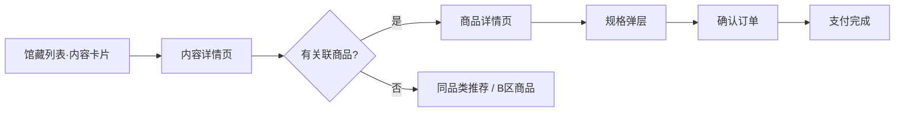

# 馆藏页重构 PRD（共创稿）

> **文档状态**：v1.2 命名定稿 · P0 已完成  
> **页面范围**：底部 Tab「馆藏」→ `pages/category/index` 及关联详情链路  
> **品牌**：山海造物 Nature's Creations · Museum Mode  
> **撰写日期**：2026-05-22  
> **命名说明**：用户可见 Tab 已由「百科」改为 **馆藏**、「收藏箱」改为 **购物车**；代码路径（`pages/category`）、云函数名（`getEncyclopediaFeed`）、埋点事件（`encyclopedia_*`）等内部标识保持不变。

---

## 1. 文档信息

| 项 | 内容 |
|---|---|
| 产品模块 | 馆藏（Category / Collection Gallery；原「百科」） |
| 关联页面 | 内容详情、商品详情、确认订单 |
| 关联云函数 | `getWikiData`、`getArticles`（可选）、`getEncyclopediaFeed` |
| 关联集合 | `cms_wikis`、`products`、`categories`、`articles`（二期可选） |
| 视觉规范 | `.cursorrules` Museum Mode；品类色仅用于品类标签 |
| 评审方式 | 本文档确认 → 交互稿/线框 → 分期开发 |

---

## 2. 背景与问题陈述

### 2.1 业务诉求（来自产品方向）

馆藏页需要完成角色转变：

1. **内容是入口** — 用户因标本故事、物种知识、策展内容而来，而非直接面对货架。
2. **电商是落点** — 通过「阅读/浏览 → 产生兴趣 → 关联商品 → 下单」完成转化。
3. **无内容关联的 SKU 仍要可见** — 作为补充供给，但整体为**次优先级**，排序在内容之后。

### 2.2 现状诊断（基于代码与文档）

| 维度 | 现状 | 问题 |
|---|---|---|
| 列表结构 | 「档案 / 可购藏品」双 Tab 切换 | 内容与商品被**并列切割**，用户需主动切 Tab 才能购物，违背「内容引流、电商承接」 |
| 内容数据源 | `cms_wikis`（云函数 `getWikiData`）+ 降级 `products` | 数据链路不统一；内容空时直接展示商品，**内容感弱** |
| 内容详情 | `wiki-detail` 仍大量降级读 `products` | 内容页与商详边界模糊，**关联商品区**未形成标准转化模块 |
| 商品关联 | `cms_wikis.relatedProductIds` 已在云函数支持 | 后台录入与前台展示未打通，**内容-商品绑定**不可用 |
| 与社区关系 | 社区（文章/视频/专题）独立 Tab | 馆藏与社区边界在文档中曾摇摆（见 `百科与社区功能定位说明.md`） |
| 电商能力 | `ProductList` 组件、商品详情页已较完善 | 缺的是**馆藏内的导购路径**，而非缺商品页 |

**结论**：馆藏页应从「分类目录 + 双 Tab 列表」重构为「**内容主导的统一信息流 + 底部/分区商品补充**」。

---

## 3. 产品定位

### 3.1 一句话定位

> **馆藏 = 山海造物的「标本内容馆」**：用博物档案与策展内容建立信任与兴趣，以关联藏品完成购买。

### 3.2 与相邻 Tab 的分工

| Tab | 定位 | 与馆藏关系 |
|---|---|---|
| 探索 | 品牌门面、活动入口、推荐分发 | 可跳转馆藏某分类/某篇内容 |
| **馆藏** | **内容馆 + 品类导购**（本 PRD） | — |
| 预约 | 门店预约、活动票务 | 与馆藏内容可交叉引流 |
| **购物车** | 待结算商品、加购清单 | 馆藏/详情「加入购物车 / 立即购买」落入此链路 |
| 我的 | 账户、订单、优惠券 | 订单回跳商品/内容 |

### 3.3 北极星指标（建议）

| 指标 | 说明 |
|---|---|
| **内容详情 → 商详转化率** | 从馆藏内容详情进入商品详情 UV / 内容详情 UV |
| **馆藏 → 下单转化率** | 7 日内从馆藏路径完成支付的用户占比 |
| **关联商品点击率** | 内容详情内「相关藏品」模块 CTR |
| **纯商品区曝光占比** | 无内容 SKU 区块 PV 占总馆藏 PV（应低于内容区，作健康度参考） |

---

## 4. 设计原则

1. **Content First** — 首屏与主列表默认展示内容卡片，不出现「纯货架」首屏。
2. **Commerce as Destination** — 每条内容路径必须能到达可购 SKU（有关联则精准，无关联则品类/搜索兜底）。
3. **One Scroll, Two Layers** — 同一滚动流内：上层内容、下层补充商品；**不做 Tab 硬切换**。
4. **Explicit Link, Graceful Fallback** — 优先 `relatedProductIds`；无绑定则同品类推荐；再无则进入「本类可购」补充区。
5. **Museum, Not Marketplace** — 视觉保持暗色博物馆感；价格/购买是「铜牌下的藏品标签」，不是电商大促风。
6. **Reuse, Don't Rebuild** — 复用 `ProductList`、商品详情、确认订单、优惠券链路；重构聚合层与详情模板。

---

## 5. 目标用户与核心场景

| 用户 | 场景 | 期望路径 |
|---|---|---|
| 自然爱好者 | 按「昆虫馆」浏览蝴蝶档案 | 分类 → 内容卡片 → 物种详情 → 关联标本商品 → 购买 |
| 送礼买家 | 搜索「甲虫」 | 搜索 → 内容+商品混合结果 → 被故事打动 → 下单 |
| 复购藏家 | 已知品类，找新品 | 切到分类 → 快速滑到「本类可购」→ 商品详情 |
| 内容党 | 阅读专题/档案 | 深度阅读 → 文末/侧栏相关藏品 → 加购 |

---

## 6. 信息架构（重构后 · v1.1 极简布局）

```
馆藏 Tab
├── 吸顶区（fixed）
│   ├── 标题「馆藏」+ 副标题（拉丁分类名 / 档案·可购统计）
│   ├── 搜索入口 → 跳转搜索页（带当前品类 scope 参数）
│   └── 一级品类横滑 Pill（全部 / 昆虫 / 植物 / 海洋 / 矿石…）
├── 主滚动区（全宽单列）
│   ├── 【A 区】标本档案 — 左图右文列表行
│   │   ├── 类型标签、标题、拉丁名、摘要
│   │   └── 关联藏品转化条（若有 relatedProductIds）
│   ├── 【B 区】本类可购 — 双列商品网格
│   │   └── 仅孤儿 SKU（未被 cms_wikis 关联）
│   └── 无限下拉 / 空状态 / 到底提示
└── （已移除）左侧分栏、二级 Chip、Hero Banner、档案/可购 Tab
```

### 6.1 布局变更说明（v1.1）

| 原方案（PRD v1.0 线框） | 现实现（v1.1） | 理由 |
|---|---|---|
| 左侧一级品类导航 | **顶部横滑 Pill** | 全宽内容区，减少左右分栏认知负担 |
| 品类 Hero Banner | **副标题一行** | 首屏让给内容/商品，提升电商浏览效率 |
| 二级 Chip 筛选 | **移除**（P1 可进搜索页） | 简化交互；精细筛选交给搜索 |
| 左图右文 / 双列网格 | A 区列表 + B 区网格 | 内容保留博物质感，商品区对齐电商习惯 |

### 6.2 移除/替代项

| 现状 | 重构后 |
|---|---|
| 「档案 / 可购藏品」Tab | **删除 Tab**，同一列表内 A/B 两段 |
| 左侧 sidebar + 顶部分 Tab | **顶部 Pill + 单列流** |
| 内容空时整页降级为 products | **A 区空状态**；B 区仍展示可购 SKU |
| `goToWikiDetail` 与 `goToDetail` 双入口混乱 | 主点击 → 内容详情；转化条 → 商详（带 `from=wiki`） |

### 6.3 搜索联动

从馆藏点击搜索栏跳转 `/pages/search/index`，携带参数：

- `category` — 品类中文（如 `昆虫`）
- `categoryId` — 品类 ID
- `categoryName` — 展示名（如 `昆虫馆`）

搜索页顶部展示「范围 · {品类}」，可一键切回「全部品类」；结果排序：**档案优先 → 商品 → 活动/标本师**（品类 scope 下活动/标本师不展示）。

---

## 7. 列表卡片与排序规则

（与 v1.1 一致，略）

### 7.1 内容卡片（主优先级 · A 区）

**数据来源**：`cms_wikis`（`status=published`），按当前一级/二级分类过滤。

**卡片信息**：封面图、标题、拉丁名、摘要、转化条（`from=wiki&wikiId=` 埋点）。

### 7.2 纯商品卡片（次优先级 · B 区）

孤儿 SKU 定义与排序规则不变。

### 7.3 搜索模式

内容优先 → 商品次之；结果标注 `档案` / `藏品`。

---

## 8. 内容-电商转化路径

### 8.1 主路径



### 8.2 内容详情页

统一为 **`pages/detail/wiki-detail`**，对接 `getWikiData get_detail`。

**跳转参数**：

- 进入商详：`/pages/detail/index?id={productId}&from=wiki&wikiId={wikiId}`
- 进入确认订单：沿用现有 `navigateToConfirmOrder`

### 8.3 次路径（纯商品）

馆藏 B 区商品卡 → 商品详情 → 确认订单 → 支付。

### 8.4 兜底路径

无关联商品时展示同品类推荐；分类无档案时 A 区空状态 + B 区商品先行。

---

## 9. 数据模型与关联规则

（§9.1–9.2 不变）

### 9.3 关联维护（后台）

**店长后台 · 内容管理**：

- [x] 多选关联商品（搜索 products 标题）
- [ ] 预览：该内容将在馆藏 A 区展示，关联商品不在 B 区重复

**店长后台 · 商品录入**（P1）：

- [ ] 只读展示：已被哪篇馆藏内容关联
- [ ] 快捷创建「空白档案」并绑定当前 SKU

### 9.4 云函数 `getEncyclopediaFeed`

已实现：orphan 判定、分页、排序服务端一次完成。

---

## 10. 页面模块详细说明

（与 v1.1 一致；吸顶标题为「馆藏」）

---

## 11. 交互与视觉要点

（与 v1.1 一致）

---

## 12. 埋点与 analytics

| 事件 | 参数 | 说明 |
|---|---|---|
| `encyclopedia_content_click` | `wikiId`, `categoryId`, `hasRelatedProduct` | 内部事件名保留 |
| `encyclopedia_product_click` | `productId`, `zone`（`related` \| `orphan`） | — |
| `encyclopedia_orphan_section_view` | `categoryId` | — |
| `wiki_to_product` | `wikiId`, `productId`, `source` | 馆藏 → 商详 |
| `wiki_to_order` | `wikiId`, `productId`, `orderId` | P1 |

---

## 13. 分期交付建议

### P0 — 核心重构 ✅

- [x] 云函数 `getEncyclopediaFeed` + orphan 规则
- [x] 馆藏列表 UI：A 区内容 + B 区商品，移除双 Tab / sidebar
- [x] 极简全宽布局：吸顶 Pill + 单列流 + 商品网格
- [x] 内容详情页：`wiki-detail` + 关联商品 + 底部购买
- [x] 搜索页品类 scope 联动
- [x] 后台 `relatedProductIds` 多选录入
- [x] 商详埋点 `from=wiki`
- [x] Tab 命名：馆藏 / 购物车

### P1 — 体验增强

- [ ] 内容置顶 `pinOrder`
- [ ] 分类空状态与锚点滚动
- [ ] 商品详情回链「来自 xxx 档案」
- [ ] 商详 `wiki_to_order` 埋点

### P2 — 生态扩展

- [ ] 馆藏 A 区插入精选社区文章卡片
- [ ] 专题 `exhibition` 独立卡片样式
- [ ] 个性化排序

---

## 14. 非功能需求

（与 v1.1 一致）

---

## 15. 产品决策（v1.0 已定稿 · 2026-05-22）

| 编号 | 决策 |
|---|---|
| **Q1** | A 区**仅**展示 `cms_wikis`；社区文章仍在「社区」Tab，馆藏不放 `articles` |
| **Q2** | 同一 SKU 被**任意一篇**内容 `relatedProductIds` 关联后，**不再出现在 B 区** |
| **Q3** | 关联 SKU 售罄时，**自动推荐同品类有货商品** |
| **Q4** | 内容详情统一 **`pages/detail/wiki-detail`** |
| **Q5** | B 区**默认展开**；**无限下拉**分页 |
| **Q6** | **馆藏优先**：有档案则先内容后商品；无档案则仅展示商品 |

---

## 16. 验收标准（P0）

1. 馆藏页无「档案/可购藏品」Tab、无左侧 sidebar，同一滚动流先内容后商品。  
2. 顶部品类 Pill 切换正确；搜索携带品类 scope。  
3. `relatedProductIds` 可配置，内容详情可进商详并下单。  
4. 关联商品不出现在 B 区；孤儿 SKU 在 A 区之后。  
5. 搜索 scope、档案/商详跳转正确。  
6. Tab 显示「馆藏」「购物车」；视觉符合 Museum Mode。  

---

## 17. 附录：现状文件索引

| 文件 | 说明 |
|---|---|
| `pages/category/index.*` | 馆藏 Tab 页 |
| `pages/detail/wiki-detail/*` | 内容详情 |
| `pages/cart/index.*` | 购物车 Tab 页 |
| `components/ProductList/*` | 商品列表组件 |
| `cloudfunctions/getEncyclopediaFeed/*` | 馆藏聚合流 |
| `cloudfunctions/getWikiData/*` | 内容与分类数据 |
| `docs/百科与社区功能定位说明.md` | 定位说明（待同步更名为馆藏） |

---

**下一步**：P1 见 §13。

*山海造物 · 把山海带回家*
