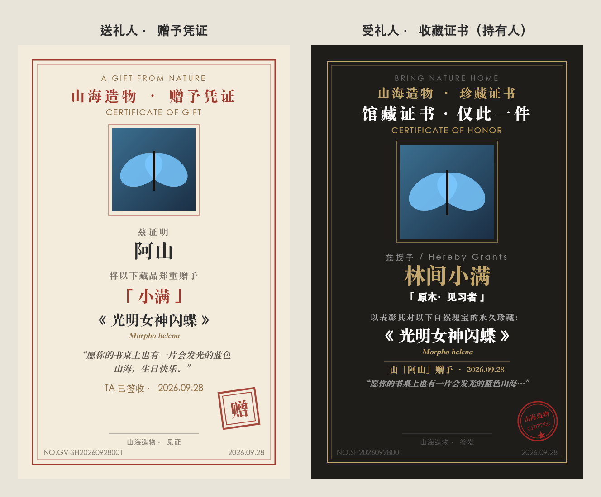
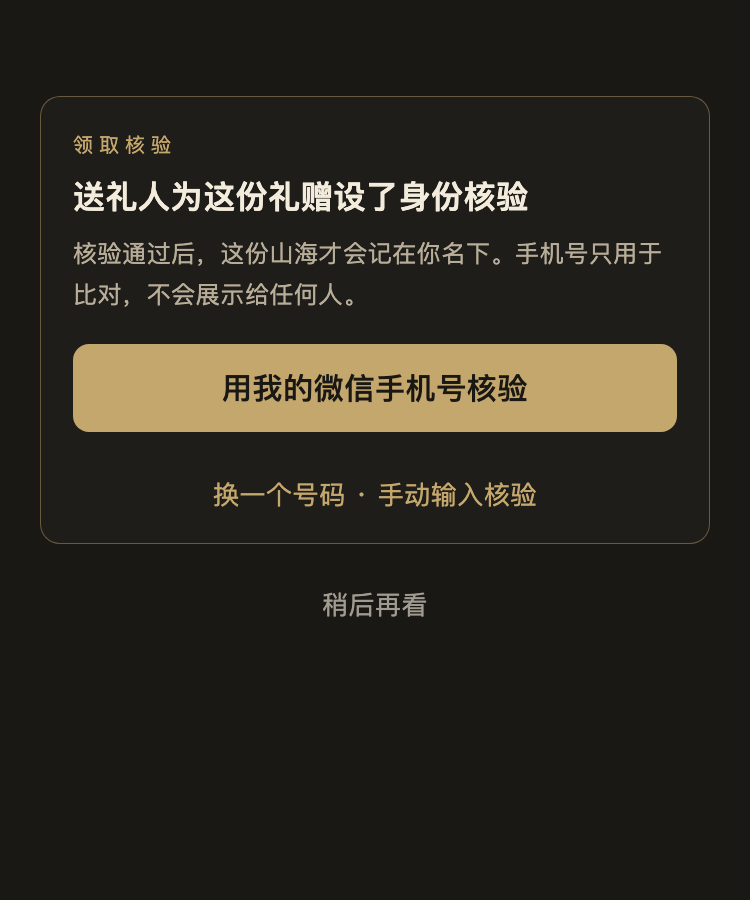
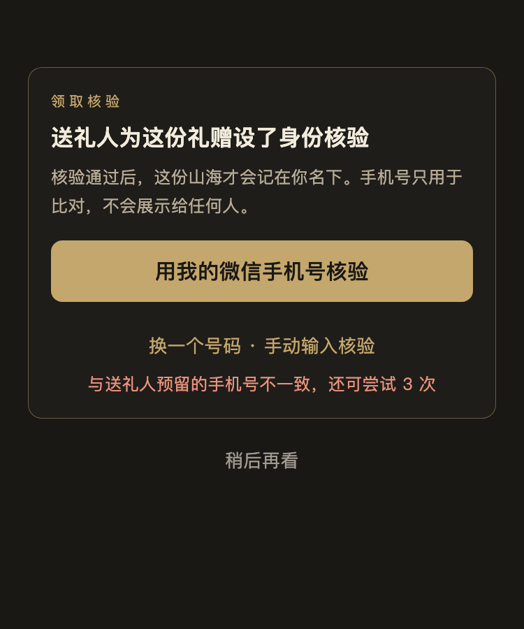
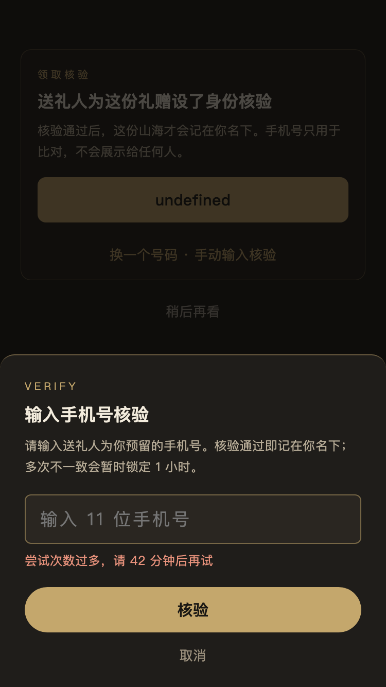
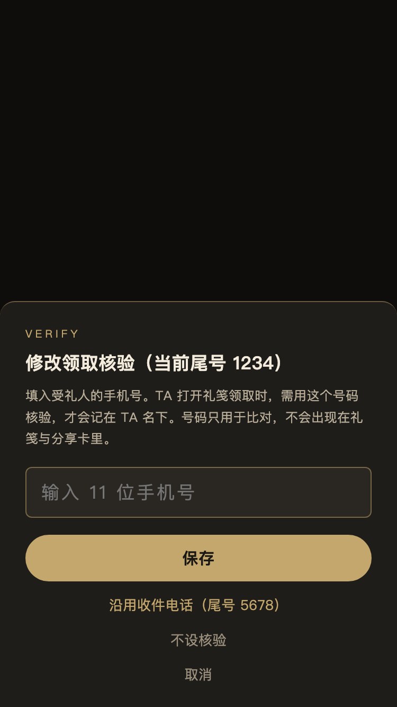
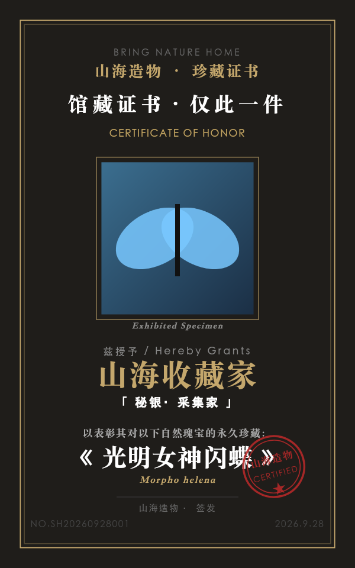
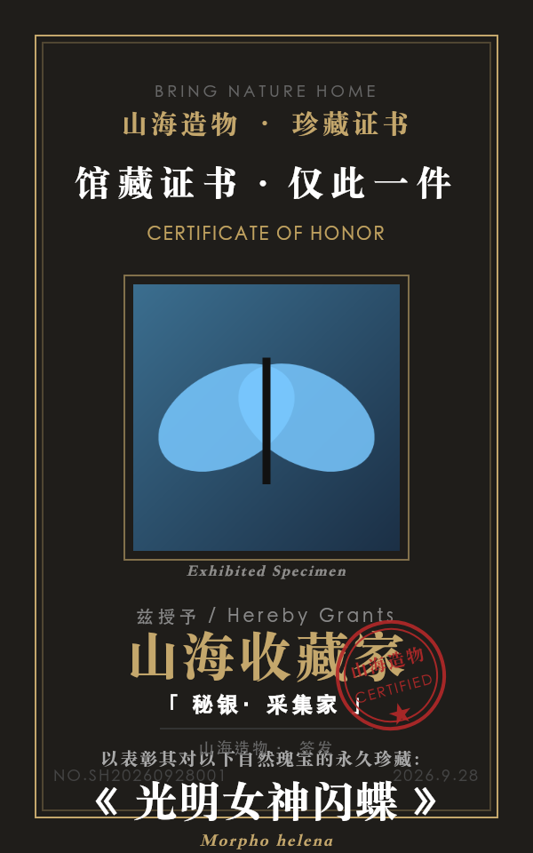
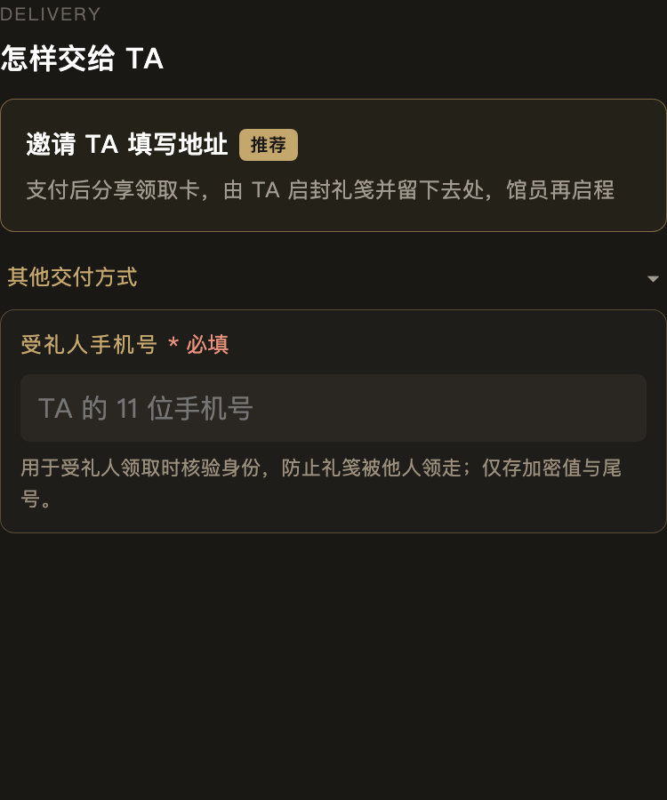
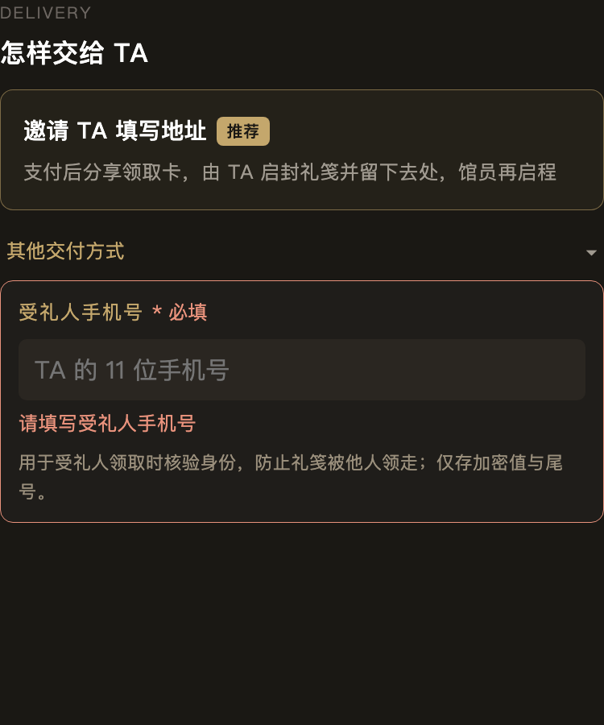

# 礼赠 · 证书与养护闭环（2026-09-28）

> **需求来源（产品负责人点名，礼赠为稳定期模块，本文件即点名范围）**：
> 「进一步打通礼赠后受礼人的收藏证书、标本养护的触达，礼赠送礼人的证书应该与受礼人不同；进一步优化这个逻辑闭环，使其更加合理。」
>
> **纪律**：只做向后兼容扩展（读时推导 / 新增可选字段 / 旁路），**不改**订单与礼赠状态机、不改已有云函数入参出参与 `success` 语义、
> 不改共享件（`orderSummary` 及副本、`messageHelper`、`utils/cache`、`imageUrl`、埋点语义）、不改 `giftMeta.js` 五副本、不改生产数据、不跑迁移。
>
> 守卫：`npm run check:gift-holder`（cross 域，与 `test:gift-mygifts` 同域；`check:gift-holder:selftest` **48 条**内存注入全部检出，2026-09-28 晚随 N1/N2/N3/N5 扩展）。
>
> **第二轮（同日晚，产品负责人对 §6 拍板）**：N3 领取核验、N2 普通单补排养护、N5 证书固化签发时间、N1 送礼人代签文案 —— 见 §8–§11。
>
> 效果图（离线渲染 `node miniprogram/scripts/render-gift-certs.mjs`，300×480@2x，与真机同一套绘制代码）：
>
> 

---

## 1. 取证：礼赠链路里「谁是谁」

| 环节 | 位置 | 送礼人 | 受礼人 |
|---|---|---|---|
| 下单 | `makeOrder` + `giftMeta.normalizeGiftMeta` | `order._openid`（= 付款人，亦写 `order.openid`） | 下单时**无**；只有 `giftMeta.recipientName`（称呼） |
| 打开礼笺 | `gift/receive` → `manageGift.getShare` + **`bindReceiver`（打开即对所有交付方式幂等绑定）** | 被拒（不能绑自己） | 写 `giftMeta.receiverOpenid` / `receiverBoundAt` |
| 收下（填址礼赠） | `manageGift.acceptGift` | 被拒（「不能收下自己送出的礼赠」） | `acceptStatus=accepted`、`receiverOpenid` |
| 填址 | `manageGift.submitAddress` | — | `addressStatus=submitted`，`status: paid_awaiting_address → paid` |
| 发货 | `managerShipOrder` | 收 `gift_shipped` | 收 `gift_shipped`（已绑定时） |
| 签收 | `confirmOrderReceipt`（送礼人或受礼人都可点）/ `sweepExpiredOrders.autoReceiveShipped`（发货 15 天自动）/ `manageGift.verifyPickup`（自提核销） | 收 `gift_delivered` 或 `gift_received` | 仅在**自己点签收**时收 `order_received`（「收藏证书已生成」） |
| 终态 | `refundOrder` / `manageGift.expireSweep` | 退款 | 收 `gift_refunded_receiver` / `gift_expired_refund_receiver` |

**领取状态机（不改）**：`status` ∈ `pending_pay → paid_awaiting_address → paid → shipped → received`（自提：`paid/ready_pickup → received`），
终态 `refunded / cancelled / void / expired_refunding`；`giftMeta.acceptStatus` ∈ `none/accepted`，`addressStatus` ∈ `none/submitted`，
`claimStatus` ∈ `none/ready/claimed`。**持有人判据只读这些既有字段**，不新增状态。

## 2. 现状断点（证据到文件/行）

| # | 断点 | 证据 | 影响 |
|---|---|---|---|
| B1 | 证书页的「兹授予 X」取**当前查看者**的昵称，礼赠单送礼人与受礼人看到的是**同一张持有证书**（各写各的名字），送礼人也被「表彰永久珍藏」 | `subpackages/business/certificate/index.js:68-87`（查 `users` 取 viewer 昵称） | 与产品口径「送礼人证书应与受礼人不同」直接冲突 |
| B2 | 证书日期是**打开页面当天** `new Date()`，不是签收日；礼赠证书没有「由谁赠予 / 赠言」 | 同上 `:92` | 证书没有礼赠语义，每次打开日期都变 |
| B3 | 证书收藏夹只查 `_openid = 我 且 status=received` → 礼赠单**只进送礼人**的收藏夹，受礼人**永远看不到**自己的证书 | `subpackages/extra/user/certificates/index.js:50-54` | 受礼人证书入口断开 |
| B4 | 「我的」证书角标同口径 → 送礼人计入、受礼人为 0 | `pages/user/index.js:1404` | 同 B3 |
| B5 | 受礼人从订单详情点「标本养护」→ 养护指南页 `orderContext` 只认 `order._openid` → 返回「无权查看」→ `denyOrderAccess()` **被踢回上一页** | `cloudfunctions/getCareSpecimens/index.js:155`、客户端兜底 `subpackages/feature/utils/careSpecimens.js:138`、`subpackages/feature/care/guide/index.js:224` | **受礼人点养护必失败**（用户可见错误） |
| B6 | 「我的藏品」（养护）只列 `_openid = 我` → 礼赠藏品挂在**送礼人**名下，受礼人列表为空 | `cloudfunctions/getCareSpecimens/index.js:61-80`、`careSpecimens.js` 客户端兜底 | 持有期服务错位 |
| B7 | 签收后养护提醒 `schedule`：客户端来源时 `openid` 被强制改成**调用者** → **谁点签收谁收养护提醒**；送礼人代点签收时提醒发给送礼人，受礼人收不到 | `cloudfunctions/sendCareReminder/index.js:275`、`subpackages/business/utils/careHelper.js:153-165`（客户端传的 `buyerOpenid` 被服务端忽略） | 养护提醒错发 / 漏发 |
| B8 | 自动收货（15 天）与门店自提核销**不调度**养护提醒 → 这两条路径签收的礼赠，受礼人永远收不到养护提醒与「证书已签发」 | `cloudfunctions/sweepExpiredOrders/index.js:265-320`、`cloudfunctions/manageGift/index.js:341-377` | 漏发 |
| B9 | 退款时取消养护提醒只按 `order._openid`（送礼人）取消 → 若提醒已排给受礼人，退款后仍会发出 | `cloudfunctions/refundOrder/index.js:338` | 退款后错发 |
| B10 | 签收后弹出的「查看养护指南 / 查看收藏证书」对送礼人也一样 | `careHelper.js` `showPostReceiptCareSheet` | 送礼人被引导去做持有人的事 |
| B11 | 「我的礼赠」已完成卡只有「订单详情」一个出口；领取页 / 送礼成功页没有证书入口 | `manageGift/index.js:1573-1575,1585`；`gift/receive`、`gift/success` | 触达点缺失 |
| B12 | `confirmOrderReceipt` 的「藏品已入柜 · 收藏证书已生成」发给**签收人**；送礼人代点签收时送礼人收到这句话 | `cloudfunctions/confirmOrderReceipt/index.js:131-136` | 文案对送礼人不准（见 §6 需点名） |

## 3. 闭环设计

### 3.1 一句话原则

**持有人 = 已绑定的受礼人（`giftMeta.receiverOpenid`，且 ≠ 送礼人）；非礼赠单 = 下单人（原行为）。**
持有人获得「收藏证书」与全部持有期服务（养护指南上下文、我的藏品、养护提醒）；
送礼人获得不同的「赠予凭证」，只收送礼人关心的节点（已收下 / 已启程 / 已到柜 / 已领取——均为既有消息，不变）。

判据唯一实现：`subpackages/business/utils/giftHolder.js`（纯函数，**读时推导、不落库**）；
逐字副本：`cloudfunctions/sendCareReminder/giftHolder.js`、`cloudfunctions/getCareSpecimens/giftHolder.js`（守卫钉住逐字相同）。extra 分包的证书收藏夹用页内 3 行分类函数（分包间逐字副本会被 `check:dup-modules` 拦下）。

### 3.2 状态 × 角色矩阵

| 状态（既有字段推导） | 送礼人：证书 | 送礼人：养护 | 送礼人：触达 | 受礼人：证书 | 受礼人：养护 | 受礼人：触达 |
|---|---|---|---|---|---|---|
| **非礼赠订单**（任何状态） | 收藏证书（**原样**） | 原样 | 原样 | — | — | — |
| 礼赠 · 待付款 / 已付未打开（未绑定） | 证书页显示「待签发：TA 签收后签发赠予凭证」 | 无 | 既有（心意备妥 / 待 TA 启封） | — | — | — |
| 礼赠 · 已绑定未签收（待填址 / 待发货 / 运输中 / 待自提） | 同上「待签发」 | 无 | 既有（已收下 / 已启程） | 证书页「待签发：藏品到你手中后签发」 | 领取页「持有期服务」卡：说明签收后证书与养护归你 | 既有 + 领取页卡片 |
| 礼赠 · **已签收 / 已核销，已绑定** | **赠予凭证**（赠予对象、日期、藏品、赠言、编号 `GV-`） | **无**（订单详情不再给「标本养护」、不进我的藏品、不收养护提醒） | 既有「礼物已到柜 / 已到店领取」；订单详情 / 我的礼赠 / 送礼成功页出「赠予凭证」 | **收藏证书**（持有人 = 本人；注明「由 X 赠予」+ 赠言摘句；日期 = 签收日） | 订单详情「标本养护」可用（修 B5）；进我的藏品；签收 3 日后养护提醒**只发持有人** | 自己点签收：既有「藏品已入柜」；**其余签收路径**（送礼人代点 / 自动收货 / 自提核销）：新增一封「这份山海已归你珍藏」（复用 `order_received` 类型，覆盖标题正文，指向证书页） |
| 礼赠 · 已签收，**未绑定**（礼笺从未被他人打开：寄给我 / 直寄且未转发） | **赠予凭证**（对象用称呼 `recipientName`，缺省「TA」） | 无（持有人未上线） | 同上 | —（受礼人任何时候打开礼笺即绑定，随后获得收藏证书；签收 ≤14 日内绑定仍会补发养护提醒） | 暂无持有人，提醒挂起不发 | — |
| 礼赠 · 退款 / 取消 / 过期退款（`refunded/cancelled/void/expired_refunding`） | 证书页「这份礼赠已结束，不签发证书」 | 待发提醒在发送时核对终态 → 作废 | 既有 | 同左 | 同左（修 B9，不改 refundOrder） | 既有 |
| 自己领自己 | 既有 `acceptGift` / `bindReceiver` 已拒绝，**不改**；送礼人始终走「赠予凭证」 | — | — | — | — | — |
| 异常数据 `receiverOpenid === 送礼人` | 视为本人持有 → 收藏证书 | 持有人 | — | — | — | — |

### 3.3 触达点（全部复用已有能力）

| 触达点 | 送礼人 | 受礼人 |
|---|---|---|
| 证书页 `business/certificate` | 赠予凭证（朱砂/象牙纸面，与持有证书一眼可分）；无养护入口；分享标题「我赠出的一份山海」 | 收藏证书（原金色版式 + 「由 X 赠予」带 + 赠言）；养护入口 |
| 订单详情（已签收） | 「赠予凭证」单按钮 | 「标本养护」+「收藏证书」（原样；养护不再被踢回） |
| 签收后弹层 | 「写一条评价 / 查看赠予凭证 / 稍后再说」 | 原样 |
| 证书收藏夹 `extra/user/certificates` | 以「赠予凭证」标签列出 | 以「受赠」标签列出（修 B3） |
| 「我的」证书角标 | 原计数 | 追加受赠已签收计数（修 B4） |
| 我的礼赠（已完成卡） | 次按钮「赠予凭证」 | 次按钮「收藏证书」 |
| 领取页 `gift/receive` | — | 「持有期服务」卡；已签收时「查看我的收藏证书 / 养护指南」 |
| 送礼成功页 `gift/success` | 已签收时「查看赠予凭证」 | — |
| 我的藏品（养护） | 不再列出赠出的藏品 | 列出受赠已签收藏品（修 B6） |
| 站内信 | 既有节点信（不变） | 「这份山海已归你珍藏」（仅非本人签收的路径）+ 3 日后「新家里还安好吗？」 |

### 3.4 养护提醒的归属（`sendCareReminder`，入参出参不变）

1. **schedule**（客户端签收后调用）：礼赠单按持有人落队列——调用者须是送礼人或受礼人；
   已绑定 → 队列 `openid = 受礼人`；未绑定 → `{ success: true, skipped: true, reason: 'gift_holder_pending' }`（沿用既有 `skipped/reason` 形状）。
   调用者 ≠ 持有人时，顺带给持有人发「已归你珍藏」信。**非礼赠单：原逻辑（`openid = 调用者`）。**
2. **process**（每日 10:00 定时）：发送前**重新推导**持有人——礼赠单终态 → 作废；持有人 ≠ 队列 openid（历史上排给送礼人的）→ 改发持有人；
   无持有人 → 标记跳过。**非礼赠单：原样发送。**
3. **礼赠持有人补扫**（随 process 同批，新旁路）：近 14 日签收、已绑定、尚无该持有人队列的礼赠单 → 补排提醒 + 补发「已归你珍藏」信
   （兜住自动收货、自提核销、送礼人代点签收三条路径，B7/B8；**不改** `sweepExpiredOrders` / `manageGift` / `confirmOrderReceipt`）。
   14 日窗口防止给很久以前的历史受礼人补发「签收已 3 天」的信。

## 4. 历史数据

全部**读时推导**：历史礼赠单无需任何字段即可按 `receiverOpenid` 判定持有人；不跑迁移、不改生产数据。
历史上已排给送礼人的待发养护提醒，在发送时被改投持有人（§3.4-2）。

## 5. 体积与部署

- 实测（`check:main-package-size`，改前 → 改后）：主包 1,495,364 → **1,495,594 B（+230 B，距 1.5M 推荐线余 4,406 B）**；
  business 1112.7 → 1127.2 KiB（+14.5，证书绘制 `certDraw.js` + 判据）；feature 2040.2 → 2043.7 KiB（+3.5）；
  extra 2059.3 → 2063.3 KiB（+4.0；extra 改前原始体积已超 2048 KiB，需以 CLI 编译后体积复核）。
- 云函数：`sendCareReminder`、`getCareSpecimens`（新增 `giftHolder.js` 副本；`sendCareReminder` 另拷 `defaults.js` 逐字副本）。2026-09-28 21:59 经 `deploy-drifted.sh` 部署，复比一致；两目录部署前仅含本次改动。`dispatchMessage` 不改（复用 `order_received` 类型 + 覆盖字段）。

## 6. 需产品负责人点名（第一轮列出；第二轮拍板状态见表末列）

| # | 事项 | 为什么没做 | 最小改法 | 第二轮 |
|---|---|---|---|---|
| N1 | `confirmOrderReceipt` 给签收人发「收藏证书已生成」——送礼人代点签收时对送礼人不准 | 改的是电商签收云函数的既有消息 | 礼赠单且签收人为送礼人时，把 `careNote` 换成「赠予凭证已签发」 | ✅ §11 |
| N2 | 自动收货 / 普通订单门店自取核销后**非礼赠单**也不排养护提醒 | 本轮要求非礼赠订单行为完全不变 | 在 `sweepExpiredOrders` 与 `managerShipOrder` 自取核销后调 `sendCareReminder.schedule` | ✅ §9（改为统一补扫，不动两处调用方） |
| N3 | `bindReceiver` 打开礼笺即绑定：群聊里第一个点开的人就成了持有人 | 改的是礼赠领取状态机 | 绑定改为「收下」动作触发，或需送礼人确认 | ✅ §8（按送礼人预留手机号二次核验） |
| N4 | 签收人是送礼人时，受礼人从未上线（未绑定）→ 持有证书无人领取；可考虑在「赠予凭证」上附「请 TA 打开礼笺认领收藏证书」的分享 | 新交互，需产品定夺 | 赠予凭证页加「把认领链接交给 TA」按钮（复用 `getGiverShare.sharePath`） | ⏳ 仍待点名 |
| N5 | 非礼赠证书日期仍是「打开当天」 | 非礼赠行为不变 | 改为 `receiveTime` | ✅ §10（固化签发时间 + 固化证书图） |

## 7. 真机验收清单

1. 送礼人 A 送 B（填址礼赠）→ B 收下填址 → 发货 → **B 点签收**：B 订单详情「标本养护」可打开（不被踢回）、「收藏证书」显示 B 的昵称与「由 {A 的署名} 赠予」、日期为签收日；A 订单详情只有「赠予凭证」，凭证写「赠予 {称呼}」。
2. 同上但 **A 点签收**：A 的签收弹层是「查看赠予凭证」；B 收到「这份山海已归你珍藏」；3 日后养护提醒只到 B。
3. 自提礼赠核销 / 发货 15 天自动收货：次日 10:00 后 B 收到「已归你珍藏」信；3 日后收到养护提醒。
4. 证书收藏夹：A 看到「赠予凭证」标签，B 看到「受赠」标签；「我的」证书角标 B 不再为 0。
5. 我的礼赠已完成卡：送出侧次按钮「赠予凭证」，收到侧「收藏证书」。
6. 未签收时从订单详情进证书页：显示「待签发」；退款单显示「已结束」。
7. **普通订单**：证书页、我的藏品、养护提醒、证书收藏夹与改动前一致。
8. **（第二轮）领取核验**：A 送 B 时在「送给 TA」页填 B 的手机号 → 送礼成功页显示「领取核验 · 尾号 xxxx」；把礼笺发到群里，C 打开 → 看到核验面板、看不到自提领取码、不会被记为持有人；C 连输 5 次错号 → 第 6 次提示「请 N 分钟后再试」，全程提示里不出现 B 号码的任何数字；B 打开 → 「用我的微信手机号核验」一次通过（B 的微信绑定号 = A 填的号），或手输完整号通过 → 进入原有领取流程。
9. **（第二轮）送礼人自己打开礼笺**：不出核验面板以外的领取入口，核验也不会通过；「我的礼赠 → 我送出的」卡片上「领取核验」可设置/修改/清除（TA 领取后变只读）。
10. **（第二轮）未设号的礼赠 / 历史礼赠**：领取流程与改动前完全一致。
11. **（第二轮）普通单**：发货 15 天自动收货 / 门店自取核销后，次日 10:00 的补扫给下单人排养护提醒（3 日后到达）；手动签收过的不重复收到。券类/积分兑换单不排。
12. **（第二轮）证书固化**：普通单第一次打开证书 → 生成后再进 → 秒开同一张图（不再有铸造动画），日期为签收日而非打开当天；改昵称后收藏证书不变（像实体证书）；赠予凭证在 TA 签收后再进会重新签发一次（凭证文字变了）。矮屏机（如 SE）证书底部签发行与编号不再挤在一起。
13. **（第二轮）送礼人代点签收**：送礼人收到的消息是「赠予凭证已签发」，不再是「藏品已签收 / 收藏证书已生成」。

## 8. N3 · 礼笺领取身份核验（第二轮，产品负责人原话：「此处应该做一个核验，如输入礼赠手机号进行二次身份核验」）

### 8.1 取证：受礼人手机号现在有没有

| 位置 | 有没有受礼人手机号 | 结论 |
|---|---|---|
| 送礼表单 `feature/gift/compose` | **没有**。只有称呼、礼笺正文、交付方式 | 需新增可选字段 |
| `giftMeta`（makeOrder `normalizeGiftMeta` 白名单） | 没有；只有 `receiverPhoneMasked`（受礼人**填址后**的收件电话打码） | 不能用于领取前核验 |
| `order.address.phone` | 仅「直寄 TA」（`ship_to_receiver`）有，且是**送礼人**填的收件电话 | 可作「沿用收件电话」快捷项，不能默认当核验号 |
| `orders` 集合读权限 | `cloudbase/rules/orders.json` = `read: auth != null` —— **任何登录用户可按 id 读任何订单** | **手机号与其哈希都不能落 orders**（11 位手机号哈希可在秒级暴力还原）→ 见 §8.4 的 P0 报备 |

### 8.2 方案

- 送礼人**可选**填「受礼人手机号」：送礼页（compose）输入 → 经内存 `globalData` 带到送礼成功页 → 服务端 `manageGift.setReceiverPhone` 落库。**不经过 makeOrder / 下单契约**（稳定期：不改下单入参）。送礼成功页与「我的礼赠」可在 TA 领取前设置 / 修改 / 清除；「直寄 TA」可一键沿用收件电话。
- 存储：新集合 **`gift_receiver_verify`**（`_id` = orderId，规则 `read:false / write:false`，仅云函数读写）：`salt` + `phoneHash = sha256(salt:phone)` + `phoneTail` + `attempts[]` + `verifiedOpenid/verifiedAt/verifyMethod`。**不存明文**。订单上只加布尔 `giftMeta.receiverVerify`（点路径更新；`normalizeGiftMeta` 只在下单时跑，五份 `giftMeta.js` 不动）。
- 领取门：`acceptGift` / `submitAddress` / `bindReceiver` 三个绑定入口在原有校验之后加同一道 `receiverVerifyGate` —— 设了号且未核验 → `{ success:false, code:'VERIFY_REQUIRED' }`（新错误码，旧客户端按普通失败展示，不会误绑定）。**已有入参出参与 success 语义不变**；未设号时门直接放行。
- 核验 `manageGift.verifyReceiver`（新 action）：
  - **优先** `method:'account'`：比对受礼人账号上**经微信授权**的手机号（`users.phone` 且有 `phoneVerifiedAt`，由既有注册链路 `authPhone` 写入）。客户端先调既有 `requirePhone`（注册/登录只调用、不改）。
  - **备选** `method:'manual'`：手输完整 11 位（兼容 +86）。
  - 服务端比对；**失败只回「不一致 + 剩余次数」**，不回任何号码片段；限次 **每人每单每小时 5 次**、**每单每小时 20 次**（防多账号轮试），超限 `VERIFY_LOCKED` + `retryAfterMin`。
  - 送礼人调用 → `IS_GIVER`（送礼人打开礼笺永远不会被绑定为受礼人；原 `bindReceiver` 已拒送礼人，保持）。
  - 通过即绑定：`giftMeta.receiverOpenid` + `receiverBoundSource: phone_verify_account|manual`，之后走原有领取流程（收下/填址/自提）。
- 自提领取码：`getShare` 对「设了号且非已绑定受礼人」的查看者清空 `claimCode / claimQrPayload`（并回 `verifyRequired:true`），**防持链接者绕过核验直接到店核销**。
- 领取页（receive）：`bindReceiver` 回 `VERIFY_REQUIRED` 或 `gift.verifyRequired` → `.actions` 区换成核验面板、隐藏持有期服务卡；错误以行内文字展示（弹窗棘轮不增）；通过后重新 bootstrap。

| 领取页核验面板 | 核验不一致（不泄露号码） | 手输核验弹层（限次锁定） | 送礼人设置/修改 |
|---|---|---|---|
|  |  |  |  |

（离线预览：`node miniprogram/scripts/render-gift-verify-preview.mjs`，结构与样式从真 WXML/WXSS 现读；字体与真机不同。）

### 8.3 未设号的礼赠（含全部历史礼赠）：**保持现行为**

理由：① 历史礼赠没有可比对的号码，强行加「轻核验」（如称呼问答）既无安全性又会把已经在走的礼赠卡住；② 核验是送礼人的**主动选择**，默认不打扰送礼体验；③ 送礼人随时可在「我的礼赠」给**尚未领取**的礼赠补设号码，补设即生效。残余风险（未设号时仍是「第一个持链接打开的人成为持有人」）列入 §12 待点名。

### 8.4 隐私与权限说明

- 明文号码只出现在：送礼人输入框 → 云函数入参（HTTPS）→ 内存中加盐哈希后丢弃。客户端 `globalData` 暂存 ≤ 2 小时、用后即清、不落本地缓存。
- 出参：送礼人侧只有**尾号**（`phoneTail` / `verifyPhoneTail`）；受礼人侧任何响应都不含号码、尾号、哈希（守卫 I 断言 `getShare` / `listMine` / 失败响应）。分享卡、礼笺、`onShareAppMessage` 均不含号码。
- `gift_receiver_verify` 规则 `read:false / write:false`（仓库 `cloudbase/rules/gift_receiver_verify.json` ↔ 线上 CUSTOM 规则一致，`provision-gift-receiver-verify.cjs` 已执行，只建空集合）。
- **P0 报备（需产品负责人点名，本轮未改）**：`orders` 集合规则 `read: auth != null`，任何登录用户可按订单 id 读取他人订单，**`address.phone`（收件电话明文）与 `giftMeta.receiverPhoneMasked` 等均可被读取**。本轮新字段已刻意避开 orders；orders 本身的读规则收紧会影响订单详情/证书页等大量客户端直读，属稳定期共享契约，未动。

## 9. N2 · 普通单自动收货 / 自提核销补排养护提醒

- 落点：`sendCareReminder` 定时 `process` 同批的补扫（原「礼赠持有人补扫」扩展为 `sweepReceivedOrders`），**不改** `sweepExpiredOrders` / `managerShipOrder`（稳定期）。
- 范围：`status=received` 且 `receiveTime` 在近 **14 日**内，按 `receiveTime` 倒序分页（100 × 最多 5 页）。
  - 礼赠 → 已绑定的持有人（未结束），并补发「已归你珍藏」（与第一轮一致）；
  - 普通单 → **下单人**，且需有养护对象（有商品、非积分兑换 `source:'exchange'`、至少一件非券类商品）。
- 幂等：同 `(orderId, 收件人, care_tip)` **任一状态**的队列已存在即跳过 —— 手动签收时已排的（待发/已发/已取消）一律不重排；延迟 = `max(1, 3 − 已签收天数)`。
- 出参：`process` 结果里 `receivedSweep: { scanned, scheduled, gift, plain }`（原 `giftHolders` 字段为本工作流第一轮新增、无调用方依赖，已替换）。

## 10. N5 · 证书日期 = 签发时间，固化后直接展示

- 签发时间：`giftHolder.certIssuedAt(order)` = `certMeta.issuedAt` → `receiveTime` → `giftMeta.claimedAt` → `pickupClaimedAt` → `autoReceivedAt`（历史单读时推导，**不迁移**）；三类证书（普通 / 受赠收藏 / 赠予凭证）同一口径。
- 固化：首次签发画完后上传 `certificates/{orderId}/{kind}-{ts}.png`，调 `getCareSpecimens.saveCertificate`（新 action）写 `certMeta.issuedAt`（仅首写，取推导时间，推导不到才用服务器时间）与 `certMeta.<kind> = { fileID, sig, openid, savedAt }`。服务端按 `certKindOf(order, openid)` 鉴权（送礼人只能写赠予凭证、受礼人只能写受赠收藏证书），同签名幂等。
- 展示：证书页读 `order.certMeta[kind]`，**openid 与签名一致**直接显示固化图（`<image>`），不再重绘；图加载失败回退现场绘制。签名：收藏证书 = `kind|签发日|v2`（持有人信息以首次签发为准）；赠予凭证另含对方状态与称呼（TA 签收后重签一次）。
- 版式：普通证书底部拥挤是矮屏（高 < 560）把 560 设计高硬塞进去导致；改为按 `h/560` 等比缩放整张版式（金样尺寸 315×560 **逐条不变**，守卫 D 金样断言仍过）。

| 300×480 改后（等比缩放） | 315×560 金样（不变） |
|---|---|
|  |  |

## 11. N1 · 送礼人代点签收的消息

`confirmOrderReceipt`：礼赠单且签收人是送礼人（且不是已绑定受礼人）→ 直接调 `dispatchMessage`（`order_received` 类型 + 覆盖 `title/content/actionUrl`，去重键不变）发「**赠予凭证已签发**：收藏证书与养护提醒归受礼人所有（未绑定时加『TA 打开礼笺即可领取』）」，跳转赠予凭证页；覆盖下发失败回退原消息。受礼人自己签收与普通单**原样**。共享件 `messageWrite` 不动。

## 12. 第二轮字段、改动、部署、体积

- **新字段**（均可选，已同步 `cloudbase/schema/orders.md`、新增 `cloudbase/schema/gift_receiver_verify.md`）：`orders.giftMeta.receiverVerify`（bool）、`orders.giftMeta.receiverBoundSource` 新值 `phone_verify_account|manual`、`orders.certMeta{ issuedAt, holder|gift_holder|gift_voucher: { fileID, sig, openid, savedAt } }`；新集合 `gift_receiver_verify`（`admin/src/cloud.js` COLLECTIONS ↔ rules ↔ schema 三处同步）。
- **新 action**：`manageGift.setReceiverPhone / getReceiverVerify / verifyReceiver`、`getCareSpecimens.saveCertificate`；新错误码 `VERIFY_REQUIRED / VERIFY_MISMATCH / VERIFY_LOCKED / NEED_PHONE / IS_GIVER`。既有 action 入参出参与 `success` 语义不变（`getShare` 仅新增可选 `gift.verifyRequired`，`listMine` 送出项新增可选 `receiverVerify/verifyPhoneTail/verifyEditable`）。
- **部署（2026-09-28 晚，逐个单函数）**：`getCareSpecimens`、`sendCareReminder`、`confirmOrderReceipt` 经 `deploy-drifted.sh <函数名>` 部署，复比一致；`manageGift` 目录含 B2B/供应商流**未提交**的 `staffGuard.js`（新增采购/供应商角色）与 `giftMeta.js` 注释改动，为不替它们上线，改用隔离副本部署（仅 `index.js` 为新，其余文件取 HEAD = 原线上），部署后拉回线上代码逐文件核对一致。故 `manageGift` 单函数复比会显示 `staffGuard.js / giftMeta.js` 仍「不一致」——那是其它流的待部署改动，不归本流。
- `deploy-drifted.sh`：修正「指定函数时第 1 步仍全量比对」—— 指定函数则只比对这些函数（产品负责人 2026-09-28 纪律）。
- **体积**（`check:main-package-size`，本轮前 → 后）：主包 1,495,594 → 1,497,196 B（本流未改主包文件，差额来自并行流）；business 1127.2 → 1132.7 KiB（+5.5，证书固化）；feature 2043.7 → 2061.8 KiB（**+18.1**，核验弹层组件 6.2 KB + 送礼/成功/我的礼赠/领取四页接线；原始体积已超 2048 KiB，**上传前须用 CLI/开发者工具以编译后体积复核**）；extra 2063.3 → 2064.6 KiB（本流未改 extra）。

## 13. 仍待点名

| # | 事项 | 说明 |
|---|---|---|
| N4 | 赠予凭证页加「把认领链接交给 TA」 | 未动（第一轮原样） |
| P0 | `orders` 读规则 `auth != null` → 他人订单收件电话可读 | 见 §8.4；收紧需改客户端直读链路，属稳定期共享契约 |
| ~~N3-残余~~ | ~~未设号礼赠仍是「第一个持链接打开者成为持有人」~~ | **已拍板并落地（§14）**：新单强制填写；历史未设号礼赠保持原行为 + 强提示补填 |
| 体积 | feature 分包原始体积 2061.7 KiB | 若编译后超 2M，需把礼赠某页迁分包（非本轮点名范围） |
| 全量强制 | 旧版客户端下单暂不拒 | 新版小程序全量后按 §14.3 打开开关 |

## 14. 第三轮 · 受礼人手机号强制填写（产品负责人拍板：「强提示送礼人填写受礼人手机号码，并强制填写」）

### 14.1 入口取证

全仓 `pages/ subpackages/ utils/ components/` 里**只有** `subpackages/feature/gift/compose/index.js` 组装 `giftMeta` 下单（守卫 J 段扫描锁死）。进入 compose 的入口：商品详情「赠予」两处按钮（`detail/index.js`）、礼赠馆（`hub/index.js`）。购物车 / 图鉴详情 / 直播间走 `navigateToConfirmOrder` 但**不带 giftMeta**，无礼赠路径。

### 14.2 改动

- **前端**：compose「交付方式」下手机号改为必填（`* 必填` 标记 + 用途说明「用于受礼人领取时核验身份，防止礼笺被他人领走；仅存加密值与尾号」）；空号 / 非 11 位 → 阻断支付、滚动到该字段并聚焦、行内红字报错（不弹原生框）。号码经 `globalData.giftReceiverPhone`（2h 有效）带到 `business/confirm-order`；confirm-order 提交前再校验一次，缺号则返回 compose 并定位该字段（非从 compose 进入时用自有 AppModal 提示）。
- **服务端（`makeOrder`，稳定契约，产品负责人点名）**：只加可选入参 `giftReceiverPhone`、`clientCaps: ['gift_receiver_phone_v1']`，新错误码 `GIFT_RECEIVER_PHONE_REQUIRED`，礼赠单响应新增可选 `receiverVerify`；已有字段与 `success` 语义不变。带号时下单即写 `gift_receiver_verify`（`_id` = 订单号，只存加盐哈希 + 尾号）并置 `giftMeta.receiverVerify: true`（在 normalize 之后追加，`giftMeta.js` 各副本不动）；写失败则回退标记，由成功页原有补存兜底。核验逻辑抽到 `giftReceiverPhone.js`，`makeOrder` 与 `manageGift` 两份**逐字节一致**（守卫比对）。
- **历史礼赠**：行为不变；「我的礼赠」与支付成功页对**未设号且未领取**的礼赠显示醒目「建议补填受礼人手机号，防礼笺被他人领走」，点即进补设弹层。

### 14.3 兼容策略与全量开关

| 客户端 | 带 `clientCaps` | 缺号 | 结果 |
|---|---|---|---|
| 新版 | 是 | 是 | 拒：`GIFT_RECEIVER_PHONE_REQUIRED` |
| 新版 | 是 | 否 | 下单 + 写核验 |
| 旧版 | 否 | — | 照旧下单（不拒、不写核验） |

**新版小程序全量后**二选一打开「对所有客户端强制」：① 云控制台给 `makeOrder` 加环境变量 `GIFT_PHONE_ENFORCE_ALL=1`（无需发版，删掉即回退）；② 把两份 `giftReceiverPhone.js` 的 `ENFORCE_ALL_DEFAULT` 改为 `true`，部署 `makeOrder`（`manageGift` 同步副本）。当前默认**关**，线上 `makeOrder` 无环境变量（已核）。

### 14.4 部署 / 体积 / 守卫

- **部署**：`makeOrder`、`manageGift` 各一次。两目录均含其它流未提交改动（`giftMeta.js` 注释；`manageGift/staffGuard.js`），故用隔离副本（这些文件取 HEAD = 原线上），部署后拉回线上代码逐文件核对一致。
- **体积**：feature 2061.8 → 2061.7 KiB（**净 −0.1**，靠压缩注释与核验样式抵消）；business 1132.7 → 1134.2 KiB（+1.5，confirm-order）；主包未动。
- **守卫**：`check:gift-holder` 新增 J 段（入口唯一性、compose 必填与报错、confirm-order 带标记与预检、开关默认关、`makeOrder` 运行时：新版缺号 / 非法号拒、旧版放行、env=1 拒旧版、带号写哈希不泄明文、普通单不受影响、强提示文案），自检注入 48 → **61** 全检出。

### 14.5 版式预览（离线渲染真 WXML/WXSS，字体与真机不同）

 

### 14.6 真机验收

1. 送礼编排页：手机号空 → 点支付被拦、页面滚到手机号并聚焦、红字「请填写受礼人手机号」；输 10 位 → 「受礼人手机号需为 11 位」；输入即清除报错。
2. 填号支付成功 → 成功页显示「尾号 xxxx」核验已设；受礼人打开礼笺需核验。
3. 旧版小程序（未发新版的体验版 / 线上版）送礼下单仍成功。
4. 「我的礼赠」/ 成功页：历史未设号且未领取礼赠显示「建议补填」，点开可补设。
5. 普通单（购物车 / 详情直接买）下单不受影响。
